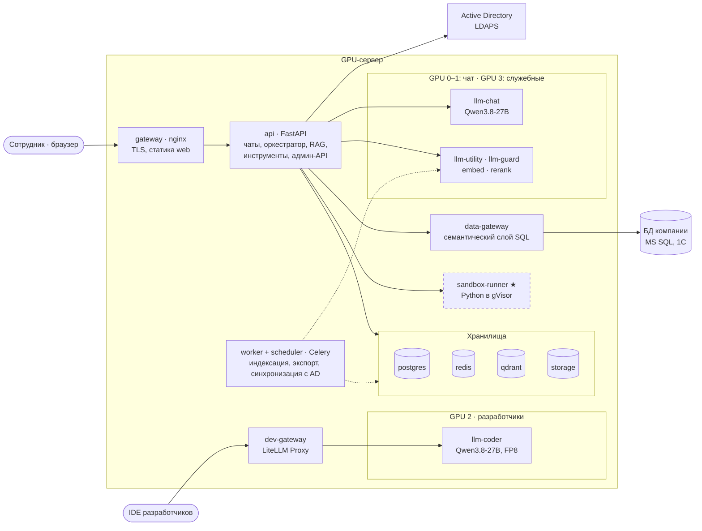
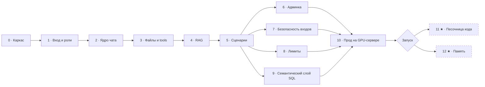

# Корпоративный ИИ-ассистент — ТЗ и план разработки

Версия от 31.10.2026 · автор: Andrew

## 0. Как пользоваться документом

Документ — единственный источник требований: агент-разработчик реализует систему по этапам из §19, а разделы 1–18 описывают, что и как строить.

- **Людям:** §1–3 — что строим и на каком железе; §6–13 — функции; §19 — этапы и критерии приёмки; §21 — принятые решения и что осталось уточнить.
- **Агенту:** сначала §20 (правила работы) и §19 (этапы), перед каждым этапом — разделы, на которые он ссылается. Неясное не додумывать: записать вопрос в `docs/status.md`, взять вариант по умолчанию из этого документа, пометить `TODO(question)`.
- Документ экспортируется в Markdown и кладётся в репозиторий как `docs/SPEC.md`. Любое изменение требований — правка SPEC и запись в `CHANGELOG.md`.

| Метка | Что значит |
| --- | --- |
| MUST | обязательно к запуску |
| SHOULD | желательно к запуску; допустимо перенести в первый релиз после запуска |
| ★ | задача со звёздочкой: делаем после запуска, но точки расширения закладываем сразу |
| FUTURE | не делаем; архитектура не должна мешать добавить позже |

«Допущение» — решение по умолчанию, которое нужно подтвердить (§21). Если оно меняется, правится конфигурация или один раздел, а не архитектура.

## 1. Цели, рамки и допущения

Строим в закрытом контуре корпоративного чат-ассистента для 200+ сотрудников и API моделей для агентного кодинга разработчиков — всё на одном сервере с 4× A100.

**Входит в первую версию**

- Веб-чат: вход через AD, история и папки, вложения, режим thinking, стриминг, корпоративные сценарии, лимиты.
- RAG трёх уровней: общие коллекции, коллекции ролей (отделов), личная база знаний пользователя. Поиск гибридный (BM25 + векторный) с реранкером.
- Инструменты: чтение документов, генерация файлов, данные из SQL-БД через семантический слой, скрытый репорт о нарушениях; ★ — песочница Python.
- Админ-панель: пользователи, все чаты и сообщения (включая удалённые), входы, инциденты, лимиты, базы знаний, сценарии, модели, аудит.
- Модели для разработчиков: OpenAI-совместимый API с персональными ключами и лимитами.

**Не входит (FUTURE)**: генерация изображений, голос, мобильное приложение, поиск в интернете, разбор картинок во вложениях, кластер из нескольких серверов, внешние облачные LLM, вход через Kerberos, уведомления об инцидентах вне админки, интеграция с service desk. Архитектура не должна мешать добавить это позже.

**Допущения**

| Параметр | Значение | Статус |
| --- | --- | --- |
| GPU | 4× A100 80 ГБ с NVLink | подтверждено |
| ОС и рантайм | Ubuntu Server (24.04 LTS), Docker Compose, NVIDIA Container Toolkit | подтверждено; версия Ubuntu — допущение |
| Сеть | На старте у сервера есть интернет, позже его отключат. Система с первого дня работает без внешних обращений, обновления — офлайн-бандлом (§16.3) | подтверждено |
| Вход | Логин и пароль домена через LDAPS (636) или LDAP + StartTLS; сервисная учётка AD только на чтение. Kerberos не нужен | подтверждено |
| Структура AD | Групп по отделам нет: роли вычисляются из атрибута department, первые админы задаются в конфиге (§6.3) | допущение, уточнить при деплое |
| Нагрузка чата | 200–300 пользователей, в пике 10–20 одновременных генераций | допущение |
| Разработчики | 2–3 человека, работают через расширения IDE | подтверждено |
| Базы знаний | 7–10 ГБ документов в общих и ролевых базах на старте, без личных | оценка заказчика |
| Корпоративные БД | MS SQL; телефонный справочник — представление в MS SQL; 1С — возможно позже | подтверждено |
| Язык | Интерфейс и ответы на русском; i18n закладывается сразу | — |
| До приезда сервера | Нет GPU и доступа к AD: разработка на mock-AD (Samba AD DC) и маленькой модели или fake-LLM | — |

## 2. Архитектура

Архитектура — модульный монолит на FastAPI плюс отдельные сервисы только там, где нужна изоляция: инференс моделей, выполнение кода и доступ к корпоративным БД.



Сотрудник проходит через nginx в `api`, а `api` обращается к AD, хранилищам, вспомогательным сервисам и моделям на GPU 0–1 и 3. Разработчики попадают к своей модели на GPU 2 только через `dev-gateway`. `worker` тоже работает с хранилищами и эмбеддингами — это пунктирные стрелки.

### 2.1 Компоненты

| Компонент | Назначение | Технология |
| --- | --- | --- |
| `gateway` | TLS, маршрутизация, лимит размера загрузок, SSE без буферизации | nginx |
| `web` | SPA пользователя и админки (статика) | React + TypeScript |
| `api` | Аутентификация, чаты, оркестратор LLM, RAG, инструменты, админ-API | Python 3.12, FastAPI |
| `worker` | Фон: индексация документов, экспорт, синхронизация с AD, память, очистка | Celery |
| `scheduler` | Периодические задачи | Celery beat |
| `data-gateway` | Семантический слой над SQL-БД: каталог, функции, контролируемый text-to-SQL | FastAPI, SQLAlchemy, sqlglot |
| `sandbox-runner` ★ | Изолированное выполнение Python | FastAPI + Docker с рантаймом gVisor |
| `postgres` | Основная БД | PostgreSQL 16+ |
| `redis` | Сессии, счётчики лимитов, брокер задач, потоки генерации | Redis 7 |
| `qdrant` | Векторный поиск: RAG и память | Qdrant |
| `storage` | Загрузки, документы БЗ, сгенерированные файлы | Том на диске за интерфейсом `Storage` (S3 — FUTURE) |
| `llm-chat`, `llm-coder`, `llm-utility`, `llm-guard`, `embed`, `rerank` | Инференс моделей | vLLM, OpenAI-совместимый API |
| `dev-gateway` | Ключи, лимиты и учёт запросов разработчиков | LiteLLM Proxy |
| `monitoring` | Метрики и дашборды, включая GPU | Prometheus, Grafana, DCGM exporter |

### 2.2 Как проходит одно сообщение

1. Браузер отправляет `POST /api/chats/{chat_id}/messages`: текст, id вложений, флаг thinking, id сценария.
2. `api` проверяет сессию, блокировки и лимиты, сохраняет сообщение пользователя и пустой ответ ассистента со статусом `streaming`.
3. `api` запускает генерацию фоновой asyncio-задачей и сразу возвращает `{message_id}`.
4. Генерация: сборка промпта → RAG по режиму сценария → вызов LLM со стримингом → цикл инструментов (§8). Каждое событие пишется в Redis Stream `gen:{message_id}`.
5. Браузер читает `GET /api/messages/{message_id}/stream` (SSE). При обрыве он переподключается с `Last-Event-ID` и дочитывает пропущенное, поэтому перезагрузка страницы не теряет ответ.
6. В конце ответ, источники, файлы и трассировка сохраняются в Postgres, токены списываются в лимиты, запускаются фоновые задачи: заголовок чата, модерация, ★ память.

Кнопка «Стоп» может попасть в любой процесс `api`, поэтому отмена передаётся флагом в Redis, а генерирующий процесс прерывает запрос к модели. При перезапуске `api` незавершённые генерации помечаются статусом `interrupted`.

### 2.3 Ключевые решения (оформить как ADR)

| Решение | Почему | Отвергнутая альтернатива |
| --- | --- | --- |
| Собственный продукт | Скрытый репорт, просмотр удалённых сообщений, инциденты с логами, RAG с ролями AD и семантический слой SQL — это глубокие правки чужого кода. Плюс требование подробной документации своего кода | Форк Open WebUI: с v0.6.6 брендинг Open WebUI нельзя менять без enterprise-лицензии, если пользователей больше 50 за 30 дней ([лицензия](https://docs.openwebui.com/license/)). LibreChat (MIT) — тот же глубокий форк |
| Тонкий собственный оркестратор | Меньше скрытой логики, проще отладка и доработка | LangChain или LlamaIndex в ядре |
| SSE + Redis Streams | Однонаправленный поток, легко проходит через прокси, переподключение без потерь | WebSocket |
| Серверные сессии: cookie HttpOnly + Redis | Мгновенный отзыв сессии из админки, токен нельзя украсть через XSS | JWT в localStorage |
| Qdrant: коллекция на тип данных, права через фильтры payload | Рекомендованный Qdrant способ multitenancy; один запрос ищет по всем доступным уровням | Коллекция на каждого пользователя |
| Гибридный поиск BM25 + dense и реранкер | Векторный поиск промахивается по точным номерам, кодам и фамилиям, BM25 — по перефразам; реранкер упорядочивает общий список кандидатов точнее обоих | Только векторный поиск |
| vLLM для всех моделей | OpenAI-совместимый API, tool calling, парсеры reasoning, prefix caching, метрики | Ollama: слабее под параллельной нагрузкой |
| LiteLLM Proxy только для разработчиков | Виртуальные ключи, лимиты и учёт без своей разработки | Свой шлюз |
| Файлы — том на диске | Сервер один; интерфейс `Storage` позволяет перейти на S3 | Объектное хранилище с первого дня |

## 3. Сервер и распределение GPU

Решение: GPU 0–1 — чату, GPU 2 — разработчикам, GPU 3 — служебным моделям и резерву. Разработчиков 2–3, поэтому одной A100 им хватает с запасом, а освободившаяся карта снимает служебные модели с чата и ускоряет индексацию документов.

### 3.1 Что важно знать про A100

- FP8 на Ampere работает только как weight-only W8A16 через Marlin: экономит память, но не ускоряет вычисления, как на H100 ([vLLM](https://docs.vllm.ai/en/v0.13.0/features/quantization/fp8/)). INT4 (AWQ/GPTQ) через Marlin — способ уместить модели крупнее.
- Генерация упирается в пропускную способность памяти, поэтому меньшая разрядность весов ускоряет вывод токенов, особенно у плотных моделей.
- NVLink проверить командой `nvidia-smi topo -m`. Tensor parallel = 2 — внутри пары с NVLink; TP = 4 без полного NVLink не делать.
- MIG делит A100 на изолированные части, но такие GPU не участвуют в tensor parallel. В базовой схеме MIG не используем; для GPU 3 он — опция (3.2).
- Предпочтительны модели с гибридным вниманием (Gated DeltaNet + attention, как у Qwen3.5 и новее): KV-кэш в разы меньше, поэтому длинные договоры и контексты агентов дешевле по памяти.
- Модели адресуются по ролям (`chat`, `coder`, `utility`, `guard`, `embed`, `rerank`), а не по именам, — смена модели не требует правок кода (§8).

### 3.2 Распределение для 4× A100 80 ГБ

```text
GPU 0  │████████████████████████████████████░░┊░░│  llm-chat 0,90 (TP = 2 вместе с GPU 1)
GPU 1  │████████████████████████████████████░░┊░░│  llm-chat 0,90
GPU 2  │██████████████████████████████████▓▓▓░┊░░│  llm-coder 0,85 │ llm-fim (опц.) 0,08
GPU 3  │█████▓▓▓▓▓████▓▓▓▓░░░░░░░░░░░░░░░░░░░░┊░░│  embed + rerank 0,12 │ llm-utility 0,12 │ llm-guard 0,10 │ docling 0,10 │ резерв ~0,55

1 символ = 2 ГБ (2,5 %) · █▓ — сервисы слева направо · ░ — свободно · ┊ — предел 95 %
```

У чата две GPU целиком и без соседей; 2–3 разработчикам хватает одной карты. Больше половины GPU 3 остаётся резервом под эксперименты и рост нагрузки, а пунктир ┊ — предел 95%, выше которого память не распределяем.

| GPU | Сервис | Модель по умолчанию | Доля памяти GPU |
| --- | --- | --- | --- |
| 0 + 1 (TP = 2) | `llm-chat` | Qwen3.8-27B, BF16 (~56 ГБ весов) | 0,90 |
| 2 | `llm-coder` | Qwen3.8-27B, FP8 (~28 ГБ весов) | 0,85 |
| 2 (опционально) | `llm-fim` | малая кодовая модель с FIM для автодополнения в IDE | 0,08 |
| 3 | `embed`, `rerank` | bge-m3, bge-reranker-v2-m3 | 0,12 |
| 3 | `llm-utility` | Qwen3.5-4B, FP8 | 0,12 |
| 3 | `llm-guard` | Qwen3Guard-Gen-4B | 0,10 |
| 3 | docling на GPU (во время индексации) | модели разметки страниц и таблиц | 0,10 |
| 3 | резерв | эксперименты разработчиков, рост нагрузки | ~0,55 |

Оценка по архитектуре из карточки модели: у чата под KV-кэш остаётся около 80 ГБ — порядка 1,2 млн токенов, это десятки одновременных диалогов с длинными документами. У кодинга — около 40 ГБ, порядка 0,6 млн токенов: на 2–3 разработчиков хватит одной-двух параллельных агентных сессий по 100 тыс. токенов у каждого. Цифры проверить нагрузочным тестом (`vllm bench serve`) в первый день на сервере.

- Сумма долей памяти на одной GPU — не больше 0,95. Порядок запуска контейнеров фиксирован через `depends_on`: сначала крупная модель, затем мелкие.
- Для чата включить prefix caching и, если стабильно работает в выбранной версии vLLM, MTP-спекулятивное декодирование — оно ускоряет генерацию.
- BF16 для чата — без потерь качества. FP8 (W8A16) — если понадобится скорость генерации или больше памяти под KV; решать по бенчмарку.

Стартовые команды запуска (финальные флаги — по рецепту vLLM для выбранной версии):

```bash
# llm-chat, GPU 0–1
CUDA_VISIBLE_DEVICES=0,1 vllm serve Qwen/Qwen3.8-27B \
  --tensor-parallel-size 2 --gpu-memory-utilization 0.90 --max-model-len 131072 \
  --reasoning-parser qwen3 --enable-auto-tool-choice --tool-call-parser qwen3_coder

# llm-coder, GPU 2
CUDA_VISIBLE_DEVICES=2 vllm serve Qwen/Qwen3.8-27B-FP8 \
  --gpu-memory-utilization 0.85 --max-model-len 262144 \
  --reasoning-parser qwen3 --enable-auto-tool-choice --tool-call-parser qwen3_coder
```

Для кодинга по умолчанию та же модель, что для чата, но в FP8 на одной карте: одно семейство моделей, одни парсеры и настройки. Альтернатива для сравнения в первую неделю — Qwen3-Coder-Next в AWQ 4 бита (~45 ГБ на одной карте): она быстрее за счёт 3B активных параметров. Если разработчики будут запускать на резерве GPU 3 свои эксперименты, на этой карте включается MIG (например, 3g.40gb под служебные модели и 4g.40gb под эксперименты). Тогда эксперимент не сможет вытеснить служебные модели из памяти.

### 3.3 Кандидаты моделей

Список актуален на 31.10.2026. Финальный выбор — после бенчмарка на 30–50 своих запросах: русский язык, документы, вызов инструментов.

| Роль | Модель по умолчанию | Размер и лицензия | Почему она | Альтернативы для сравнения |
| --- | --- | --- | --- | --- |
| Чат | [Qwen3.8-27B](https://huggingface.co/Qwen/Qwen3.8-27B) | 27B, плотная; Apache 2.0; контекст 262K | Thinking включается и выключается на каждый запрос, есть `reasoning_effort`; сильна в офисных задачах и коде; гибридное внимание | Qwen3.5-122B-A10B в INT4 — больше знаний; [Gemma 4 31B](<https://en.wikipedia.org/wiki/Gemma_(language_model)>), Apache 2.0 |
| Кодинг | Qwen3.8-27B в официальной FP8-версии | 27B; Apache 2.0; 262K | Сильные результаты в агентном кодинге по карточке модели; та же модель, что у чата; помещается на одну GPU | [Qwen3-Coder-Next](https://dell.huggingface.co/models/Qwen/Qwen3-Coder-Next) в AWQ 4 бита — 80B, из них 3B активных, быстрее; Qwen3.6-35B-A3B |
| Служебная | Qwen3.5-4B, FP8 | 4B; Apache 2.0 | Заголовки, переформулировка запросов, извлечение памяти — быстро и дёшево | [GigaChat 3.1 Lightning](https://en.immers.cloud/ai/sber-ai/gigachat3.1-10b-a1.8b/) — 10B, из них 1,8B активных; MIT; сильный русский |
| Модерация | [Qwen3Guard-Gen-4B](https://sotaverified.org/papers/251014276) | 0,6B / 4B / 8B; Apache 2.0; 119 языков | Метки safe, controversial, unsafe и категории нарушений | 0,6B — если не хватает памяти |
| Эмбеддинги | BAAI/bge-m3 | 568M; 1024 измерения; 8192 токена | Лучший retrieval среди не-instruct моделей на русском бенчмарке ruMTEB ([статья](https://arxiv.org/html/2408.12503v1)); dense и sparse векторы | Qwen3-Embedding-0.6B / 4B — сравнить на своих документах |
| Реранкер | BAAI/bge-reranker-v2-m3 | ~0,6B | Мультиязычный cross-encoder | Qwen3-Reranker-0.6B / 4B |

Критерии для любой замены: деловой русский язык; надёжный tool calling через парсер vLLM; управление thinking на запрос (для чата); контекст не меньше 64K для чата и 128K для кодинга; лицензия, разрешающая коммерческое использование; работа на A100 в BF16, FP8 W8A16 или INT4.

### 3.4 Доступ разработчиков

- Разработчиков 2–3, работают через расширения IDE: Continue, Cline, Roo Code, Kilo Code — все умеют OpenAI-совместимый API. Готовые конфиги — в `docs/guides/dev-coding-setup.md`.
- Отдельный шлюз `dev-gateway` (LiteLLM Proxy) по HTTPS, доступ только из подсетей разработчиков.
- Персональный ключ на каждого: лимиты RPM и TPM, число параллельных запросов, дневной бюджет токенов, журнал запросов.
- Модели в шлюзе: `coder` — с размышлениями, для агентного режима; `coder-fast` — тот же бэкенд без размышлений, для быстрых правок (шлюз сам подставляет `chat_template_kwargs`; проверить на выбранной версии LiteLLM); `fim` — автодополнение, опционально; `embed` — для индексации кода в расширениях.
- Модель разработчиков живёт в отдельном compose-проекте `deploy/models/coder/` и закреплена за GPU 2 через `CUDA_VISIBLE_DEVICES`. Смена модели — по runbook, без влияния на чат. Эксперименты — на резерве GPU 3 по согласованию.

### 3.5 Если мощности не хватает

1. Включить CPU-offload KV-кэша (LMCache или встроенный в vLLM): 2 ТБ ОЗУ позволяют держать сотни гигабайт кэша префиксов для длинных сессий агентов.
2. Если разработчиков станет больше — отдать им резерв GPU 3 под вторую копию `llm-coder`.
3. Если вырастет нагрузка на чат — сначала поднять `max_num_seqs` и проверить очередь, затем перевести чат на FP8 и отдать освободившуюся память под KV-кэш.
4. Крайний вариант — одна большая модель на все 4 GPU (например, Qwen3.5-397B-A17B в INT4). Это максимум качества, но чат и разработчики делят GPU, а вспомогательным моделям почти не остаётся места. Рассматривать, только если 27B не устроит по итогам пилота.

### 3.6 CPU и 2 ТБ ОЗУ

- Postgres, Qdrant (держит индексы в памяти), Redis.
- Воркеры парсинга и OCR: они нагружают CPU, поэтому работают отдельным пулом с ограничением параллелизма.
- ★ Песочницы выполнения кода.
- CPU-offload KV-кэша vLLM (см. 3.5).
- FUTURE, эксперимент: очень большие MoE-модели с экспертами в ОЗУ через llama.cpp или KTransformers. Скорость низкая, подходит только для редких тяжёлых задач.

## 4. Технологический стек

Стек фиксирован: Python 3.12 + FastAPI на бэкенде, React + TypeScript на фронтенде, всё в Docker Compose. Новая зависимость появляется только с обоснованием в ADR или описании PR.

**Бэкенд**

- Python 3.12, зависимости через `uv` (lock-файл `uv.lock`).
- FastAPI, Pydantic v2, pydantic-settings — конфиг валидируется при старте.
- SQLAlchemy 2 (async) + asyncpg, миграции Alembic. Redis 7 через redis-py (asyncio).
- Фоновые задачи: Celery с брокером Redis, расписания — celery beat.
- LLM: официальный SDK `openai` (AsyncOpenAI) к OpenAI-совместимым эндпоинтам vLLM. Подсчёт токенов для бюджета контекста — `tokenizers` с токенизатором конкретной модели.
- AD: `ldap3`.
- Чтение документов: docling (PDF, DOCX, PPTX, XLSX, HTML, таблицы, OCR; при массовой индексации — на GPU 3); MarkItDown — запасной парсер; LibreOffice headless — конвертация DOC, XLS, PPT, RTF, ODF; Tesseract OCR (rus + eng); PyMuPDF — рендер страниц PDF для просмотра.
- Генерация файлов: python-docx, openpyxl, python-pptx; pandoc — Markdown → DOCX по шаблону (пока нейтральному), формулы LaTeX становятся нативными формулами Word; LibreOffice — DOCX → PDF.
- Векторы: qdrant-client; лексическая часть гибридного поиска — BM25, который считает сам Qdrant (qdrant/bm25, язык russian; запасной вариант — fastembed Bm25); реранкер — bge-reranker-v2-m3 в vLLM (/v1/rerank).
- SQL-слой: SQLAlchemy Core + pyodbc с Microsoft ODBC Driver 18 для MS SQL; sqlglot (диалект T-SQL) для разбора и проверки SQL.
- Шаблоны промптов: Jinja2, файлы в `config/prompts/`.
- Логи: structlog (JSON в stdout); метрики: prometheus-client; трассировка: OpenTelemetry (SHOULD).
- Качество: ruff (линт и формат), mypy, pytest, pytest-asyncio, testcontainers, respx.

**Фронтенд**

- React 19 + TypeScript (strict) + Vite, пакеты через pnpm.
- UI: Tailwind CSS + shadcn/ui (Radix), иконки lucide-react.
- Данные сервера — TanStack Query; состояние интерфейса — Zustand; роутинг — React Router.
- API-клиент и типы генерируются из OpenAPI (`openapi-typescript` + `openapi-fetch`), поэтому фронтенд и бэкенд не расходятся в контракте.
- Markdown: react-markdown + remark-gfm + remark-math + rehype-katex, подсветка кода Shiki, санитизация rehype-sanitize. Для корректного рендера незакрытых блоков во время стрима рассмотреть Streamdown. Mermaid-диаграммы в ответах — SHOULD.
- Просмотр PDF — pdf.js (react-pdf); таблицы админки — TanStack Table; графики — ECharts или Recharts.
- i18n — i18next, русский по умолчанию.
- Тесты: Vitest + Testing Library, Playwright для e2e. Линт: ESLint + Prettier.

**Инфраструктура**: Docker Compose (профили `dev` и `prod`), nginx, PostgreSQL 16+, Redis 7, Qdrant, vLLM, LiteLLM Proxy, Prometheus, Grafana, DCGM exporter, gVisor (`runsc`) для песочницы.

**Правила**

- Версии всех зависимостей закреплены lock-файлами, образы — по digest.
- Никаких сетевых обращений наружу в рантайме: телеметрия библиотек отключена, модели, шрифты, KaTeX, грамматики Shiki и воркер pdf.js — только локально, без CDN.

## 5. Структура репозитория и карта изменений

Монорепозиторий: код, конфигурация, развёртывание и документация лежат вместе, а карта изменений ниже (копия — в `AGENTS.md`) за минуту отвечает на вопрос «где править».

```text
ai-assistant/
├── AGENTS.md                 # правила и карта проекта для людей и ИИ-агентов
├── CLAUDE.md                 # одна строка: @AGENTS.md
├── README.md                 # быстрый старт
├── CHANGELOG.md
├── Makefile                  # dev-up, check, test, lint, e2e, gen-api, deploy, docs-check
├── docs/
│   ├── SPEC.md               # этот документ
│   ├── status.md             # прогресс этапов и открытые вопросы
│   ├── architecture/         # overview, request-flow, sse-protocol, data-model, security
│   ├── adr/                  # 0001-own-product.md, 0002-sse.md, ...
│   ├── guides/               # add-tool, add-scenario, add-model, add-admin-page,
│   │                         # add-limit-metric, ad-setup, dev-coding-setup, deploy, offline-bundle
│   ├── reference/            # config.md (генерируется), api.md, permissions.md, events.md, db-schema.md
│   └── runbooks/             # models.md, backup-restore.md, incidents.md, rotate-secrets.md
├── backend/
│   ├── pyproject.toml
│   ├── app/
│   │   ├── main.py           # сборка FastAPI-приложения, подключение роутеров
│   │   ├── core/             # config, logging, db, redis, storage, security, errors
│   │   ├── modules/          # бизнес-модули, у каждого свой README.md
│   │   │   ├── auth/         # провайдеры ldap и dev (kerberos — FUTURE); сессии; CSRF
│   │   │   ├── users/        # профиль, синхронизация с AD, фото
│   │   │   ├── rbac/         # роли, права, роли отделов из AD
│   │   │   ├── chats/        # чаты, папки, сообщения (дерево), поиск
│   │   │   ├── completions/  # оркестратор, сборка промпта, стриминг, отмена
│   │   │   ├── llm/          # реестр моделей, клиент, режимы thinking, токенизация
│   │   │   ├── tools/        # базовый класс, реестр, builtin/*
│   │   │   ├── files/        # загрузки, сгенерированные файлы, превью
│   │   │   ├── ingestion/    # парсеры, чанкинг, пайплайн индексации
│   │   │   ├── rag/          # базы знаний, поиск, реранк, цитаты
│   │   │   ├── scenarios/    # корпоративные сценарии
│   │   │   ├── memory/       # ★ память
│   │   │   ├── limits/       # политики и счётчики
│   │   │   ├── feedback/     # лайки и дизлайки
│   │   │   ├── incidents/    # ошибки, репорты модели, захват логов
│   │   │   ├── security/     # история входов, правила, блокировки
│   │   │   ├── audit/        # журнал действий админов
│   │   │   ├── exports/      # выгрузки
│   │   │   └── admin/        # админ-роутеры поверх модулей
│   │   ├── workers/          # Celery-приложение, задачи, расписания
│   │   └── cli/              # ad check, create-admin, reindex, purge
│   ├── migrations/           # Alembic
│   └── tests/                # unit, integration, security, fixtures
├── frontend/
│   ├── src/
│   │   ├── app/              # роутер, провайдеры, тема, layout
│   │   ├── api/              # сгенерированный клиент + SSE-клиент
│   │   ├── features/         # chat, sidebar, composer, message, markdown, sources, files,
│   │   │                     # knowledge-base, profile, limits, scenarios, memory, auth
│   │   ├── admin/            # pages/*, components/*
│   │   ├── components/ui/    # shadcn-компоненты
│   │   ├── lib/
│   │   └── i18n/             # ru.json, en.json
│   └── tests/                # unit и e2e (Playwright)
├── services/
│   ├── data-gateway/         # семантический слой SQL + catalog/*.yaml
│   ├── sandbox-runner/       # ★ песочница + Dockerfile образа с библиотеками
│   └── fake-llm/             # OpenAI-совместимый mock для тестов
├── config/
│   ├── models.yaml           # реестр моделей по ролям
│   ├── prompts/              # system/*.md.j2, scenarios/*.md.j2, utility/*.md.j2
│   ├── scenarios/            # встроенные сценарии (seed)
│   ├── moderation/policy.yaml
│   └── templates/            # reference.docx, presentation.pptx
├── deploy/
│   ├── compose/              # docker-compose.yml, compose.dev.yml, .env.example
│   ├── nginx/
│   ├── models/               # chat/, coder/, aux/ — compose-проекты vLLM; litellm/config.yaml
│   ├── monitoring/           # Prometheus, дашборды Grafana, алерты
│   ├── mock-ad/              # Samba AD DC + seed тестовых пользователей
│   └── offline/              # сборка офлайн-бандла
└── eval/                     # rag/questions.yaml, scenarios/*, скрипты оценки
```

**Карта изменений**

| Хочу… | Где править | Что обновить вместе с этим |
| --- | --- | --- |
| Изменить вид сообщения или кнопки под ним | `frontend/src/features/message/` | e2e-тест сообщения |
| Добавить кнопку в поле ввода | `frontend/src/features/composer/` | строки в `i18n/` |
| Поменять рендер Markdown, формул, кода | `frontend/src/features/markdown/` | тесты рендера |
| Добавить инструмент для модели | `backend/app/modules/tools/builtin/` + регистрация в `tools/registry.py` | `docs/guides/add-tool.md`, тест на fake-LLM |
| Добавить корпоративный сценарий | админка «Сценарии» или `config/scenarios/*.yaml` | промпт в `config/prompts/scenarios/` |
| Сменить или добавить модель | `config/models.yaml` + `deploy/models/` | `docs/runbooks/models.md` |
| Изменить системный промпт | `config/prompts/system/` | прогон `eval/scenarios` |
| Добавить поле профиля из AD | маппинг атрибутов в конфиге + `modules/users/` + миграция + `features/profile/` | `docs/guides/ad-setup.md` |
| Добавить страницу админки | `frontend/src/admin/pages/` + `backend/app/modules/admin/` | новое право в `docs/reference/permissions.md` |
| Добавить метрику лимитов | `backend/app/modules/limits/` | админка «Лимиты», `docs/reference/config.md` |
| Добавить тип инцидента | `backend/app/modules/incidents/` | фильтры в админке |
| Добавить набор данных или функцию SQL | `services/data-gateway/catalog/` | описания полей и примеры запросов |
| Изменить формат стрима | `docs/architecture/sse-protocol.md` → `modules/completions/streaming.py` → `frontend/src/api/sse.ts` | версия протокола, тесты обеих сторон |
| Изменить схему БД | модель SQLAlchemy + миграция Alembic | `docs/reference/db-schema.md` (генерируется) |

## 6. Аутентификация через AD и профиль

Вход — по доменному логину и паролю через LDAPS. Всё, что зависит от конкретного AD, вынесено в конфиг и проверяется одной командой `ad check` в день деплоя.

### 6.1 Провайдеры

- `ldap` (MUST): форма логина, пароль проверяется bind-ом в AD.
- `dev` (только разработка): вход под любым seed-пользователем без пароля. При `APP_ENV=prod` приложение с включённым `dev` не стартует.
- `kerberos` (FUTURE): прозрачный вход с доменных ПК на старте не нужен; интерфейс провайдеров позволяет добавить его позже (§6.6).

### 6.2 Поток входа

1. Нормализовать логин: `ivanov`, `ivanov@corp.local` и `CORP\ivanov` приводятся к sAMAccountName.
2. Отклонить пустой пароль до обращения к AD: bind с пустым паролем AD считает анонимным и «успешным».
3. Проверить счётчики неудачных попыток по логину и по IP (§13).
4. Сделать bind пользователем по UPN на первый доступный контроллер из списка.
5. Сервисной учёткой найти запись пользователя; все значения в LDAP-фильтрах экранировать.
6. Проверить, что учётка включена (бит ACCOUNTDISABLE в `userAccountControl`). Если задана `access_group`, проверить членство в ней с учётом вложенных групп (правило `1.2.840.113556.1.4.1941`).
7. Считать атрибуты по маппингу и вычислить роли: автоматическая роль отдела из атрибута department, правила по атрибутам, группы AD (если появятся), роли, выданные вручную в админке.
8. Создать или обновить пользователя (ключ — `objectGUID`), открыть сессию, записать событие входа.
9. Пользователь при любой ошибке видит одно сообщение: «Неверный логин или пароль». Точная причина — только в журнале входов.

Порог блокировки после неудачных попыток у нас должен быть ниже, чем политика блокировки в AD. Иначе перебор паролей через портал будет блокировать сотрудникам доменные учётки.

### 6.3 Конфигурация

```yaml
auth:
  providers: [ldap]                # ldap | dev (dev в prod запрещён); kerberos — FUTURE
  bootstrap_admins: [ivanov]       # логины первых superadmin; остальные роли выдаются в админке
  session:
    idle_timeout_minutes: 480
    absolute_timeout_hours: 168
  bruteforce:
    per_login: {max_failures: 5, window_minutes: 15, lock_minutes: 15}
    per_ip: {max_failures: 20, window_minutes: 15, lock_minutes: 60}
ldap:
  urls: ["ldaps://dc1.corp.local:636", "ldaps://dc2.corp.local:636"]
  start_tls: false
  ca_cert_file: /run/secrets/corp_ca.pem
  bind_dn: "CN=svc-ai-assistant,OU=Service Accounts,DC=corp,DC=local"
  bind_password_file: /run/secrets/ldap_bind_password
  base_dn: "DC=corp,DC=local"
  user_filter: "(&(objectCategory=person)(objectClass=user)(sAMAccountName={username}))"
  upn_suffix: "corp.local"
  netbios_domain: "CORP"
  access_group: ""                 # пусто — пускать всех включённых пользователей домена
  nested_groups: true
  attributes:
    guid: objectGUID
    login: sAMAccountName
    email: mail
    display_name: displayName
    last_name: sn
    first_name: givenName
    middle_name: middleName          # если пусто — из display_name по шаблону
    display_name_pattern: "{last} {first} {middle}"
    title: title
    department: department
    company: company
    office: physicalDeliveryOfficeName
    phone: telephoneNumber
    mobile: mobile
    manager: manager
    employee_id: employeeID
    photo: thumbnailPhoto
  department_roles:
    auto: true                       # роль «Отдел: <название>» создаётся из атрибута department
    rules:                           # дополнительные роли поверх автоматических
      - {attribute: department, equals: "Юридический отдел", roles: [legal]}
      - {attribute: department, contains: "ИТ", roles: [it]}
  group_roles: []                    # группы AD → роли, если такие группы появятся
  sync_interval_minutes: 60
```

Групп по отделам в AD нет, поэтому роль отдела создаётся автоматически из атрибута department, и базу знаний отдела достаточно привязать к роли «Отдел: …». Если название отдела в AD изменится, появится новая роль; админка показывает роли без привязок, чтобы перенести доступы.

Секреты — только из файлов секретов или переменных окружения, никогда из YAML в git. Полный перечень параметров генерируется в `docs/reference/config.md`.

### 6.4 Сессии

- Непрозрачный id сессии в cookie `HttpOnly; Secure; SameSite=Lax`, данные сессии — в Redis, копия для истории — в Postgres.
- CSRF-токен (double submit) на все изменяющие запросы.
- Тайм-ауты: простой 8 часов, абсолютный 7 дней; оба настраиваются.
- Админ может завершить любую сессию; блокировка пользователя сразу завершает все его сессии.
- Периодическая синхронизация с AD обновляет атрибуты и роли. Отключённых в AD — блокирует и разлогинивает.

### 6.5 Профиль

Показываем фото (`thumbnailPhoto`), ФИО, должность, отдел, компанию, офис, email, телефоны, руководителя, роли, доступные базы знаний, расход лимитов и личные настройки: тема, форма обращения, ★ память.

### 6.6 Kerberos SSO (FUTURE)

- На старте не нужен: достаточно входа по логину и паролю (решение от 31.10.2026).
- Если понадобится: админы домена регистрируют SPN `HTTP/ai.corp.local` и выдают keytab; эндпоинт `/api/auth/sso` проверяет заголовок `Authorization: Negotiate` через `pyspnego`, дальше — шаги 5–8 из 6.2. Провайдер добавляется в `modules/auth/providers/` без изменения остального кода.

### 6.7 Как проверить до приезда сервера и в день деплоя

- В dev-профиле поднимается Samba AD DC с тестовыми данными: русские ФИО (один пользователь без отчества), отделы в атрибуте department, должности, телефоны, руководители, фото; одна отключённая учётка. Группы AI-Assistant-Users и AI-Admins тоже заведены — чтобы проверить необязательные настройки `access_group` и `group_roles`.
- Команда `python -m app.cli ad check --user ivanov` и страница «Диагностика AD» в админке показывают: доступность каждого контроллера, TLS, bind сервисной учёткой, найденную запись, итоговые атрибуты, ФИО и форму обращения, отдел и вычисленные роли.
- Проверка пароля конкретного пользователя — отдельно: `ad check --user ivanov --password-prompt`.
- Первые админы задаются списком `bootstrap_admins` или командой `python -m app.cli create-admin --login ivanov`.

## 7. Интерфейс пользователя

Схема привычная — боковая панель и чат. Всё из исходных требований — MUST; добавлены базовые вещи, без которых чат неудобен: кнопка «Стоп», автозаголовки, горячие клавиши.

### 7.1 Каркас

- Слева — боковая панель: «Новый чат», поиск, папки, список чатов; внизу — аватар с меню: профиль, моя база знаний, ★ память, лимиты, тема, выход. Панель сворачивается.
- Справа — чат: шапка с названием и активным сценарием, лента сообщений, поле ввода.
- Стартовый экран: приветствие по имени и отчеству с учётом времени суток, карточки сценариев, 3–4 примера запросов.
- Ссылка «Админка» видна только пользователям с админ-правами.
- Вёрстка рассчитана на экраны от 1024 px; на телефоне — базовая работоспособность (панель выезжает поверх чата).

### 7.2 История чатов

| Функция | Требование |
| --- | --- |
| Создание | Кнопка «Новый чат» и Ctrl+Shift+O; чат попадает в список после первого сообщения |
| Заголовок | Служебная модель генерирует 3–6 слов после первого ответа; пользователь может переименовать |
| Удаление | С подтверждением. Удаление мягкое: чат исчезает у пользователя, но остаётся для админа (§13) |
| Папки | Создать, переименовать, удалить (с выбором: перенести чаты в корень или удалить их), перетащить чат в папку; в первой версии без вложенных папок |
| Закрепление | Закреплённые чаты — отдельной группой сверху |
| Группы по датам | Закреплённые, Сегодня, Вчера, Последние 7 дней, Последние 30 дней, затем по месяцам («Сентябрь»), прошлые годы — по году. Считается по дате последнего сообщения в часовом поясе пользователя |
| Поиск | Ctrl+K: по названиям и тексту сообщений, подсветка совпадения, переход к найденному сообщению |
| Производительность | Курсорная пагинация и виртуализация списка: 5000 чатов без подтормаживаний |

### 7.3 Поле ввода

- Многострочное поле: Enter — отправить, Shift+Enter — новая строка. Черновик сохраняется при переключении чатов.
- Скрепка, перетаскивание и вставка из буфера. Типы: текстовые (txt, md, csv, tsv, json, xml, yaml, html, log, ini, sql, исходный код), Office (doc, docx, xls, xlsx, ppt, pptx, rtf, odt, ods, odp), PDF. По умолчанию до 10 файлов на сообщение и до 50 МБ на файл; лимиты настраиваются.
- Файл загружается сразу при выборе. Чип файла показывает прогресс, статус обработки («читаю…», «готово», «ошибка: причина») и кнопку удаления. Отправка ждёт окончания обработки.
- Переключатель «Размышлять» (thinking) виден, только если модель сценария его поддерживает; состояние запоминается для чата.
- Индикатор активного сценария с кнопкой сброса.
- Индикатор лимита, например: «Осталось 37 из 100 сообщений · обновится в 00:00».
- Во время генерации кнопка «Отправить» становится кнопкой «Стоп».

### 7.4 Сообщения

- Сообщение пользователя: текст и чипы вложений. FUTURE: редактирование с созданием новой ветки.
- Ответ ассистента появляется по мере генерации (§8).
- Блок «Размышления» свёрнут по умолчанию и показывает время размышления; во время генерации в нём идёт живой текст.
- Шаги инструментов показываются строками статуса: «Ищу в базе знаний…», «Читаю договор.docx…», «Выполняю код…». Скрытые инструменты (репорт) не показываются никогда.
- Под каждым ответом: «Копировать» (Markdown), «Перегенерировать», «Нравится», «Не нравится». Дизлайк открывает выбор причины (неточно, не по теме, ошибка в коде, неполно, другое) и поле комментария.
- Перегенерация создаёт новую версию ответа; переключатель «‹ 2/3 ›» листает версии, все версии сохраняются.
- При ошибке — понятный текст и кнопка «Повторить». Во всплывающей подсказке — модель, время ответа и число токенов.

### 7.5 Рендер ответа

- GitHub-flavored Markdown: заголовки, списки, таблицы, цитаты, чек-листы; ссылки открываются в новой вкладке.
- Код: подсветка по языку, подпись языка, кнопка «Копировать» в каждом блоке, горизонтальная прокрутка длинных строк.
- Формулы KaTeX: строчные `$…$` и `\(…\)`, блочные `$$…$$` и `\[…\]`. Модели часто выдают делимитеры со слэшем, поэтому перед рендером они нормализуются в `$`-форму.
- Незакрытый блок кода или формулы во время стрима не ломает вёрстку.
- HTML из ответа модели не исполняется (санитизация).
- SHOULD: Mermaid-диаграммы, кнопка «Скопировать таблицу как CSV».

### 7.6 Источники RAG

- Если ответ опирался на RAG, рядом с ним — ряд карточек: номер, название документа, уровень (Общая, название роли или Личная), страница или раздел, фрагмент текста.
- Ссылки `[1]`, `[2]` в тексте кликабельны и подсвечивают свою карточку.
- Клик по карточке открывает просмотр: PDF — на нужной странице с подсветкой фрагмента; остальные форматы — текст документа с выделенным фрагментом. Есть кнопка «Скачать оригинал».
- Права проверяются при каждом открытии: пользователь видит только документы доступных ему баз знаний.

### 7.7 Сгенерированные файлы

- Карточка под сообщением: иконка формата, имя, размер, «Скачать», «Просмотр».
- Просмотр: PDF и изображения — напрямую; Markdown, CSV и текст — отрисованными; DOCX, XLSX и PPTX — через PDF-превью, которое воркер готовит в LibreOffice.
- Файлы живут вместе с чатом; удаление чата скрывает их у пользователя.

### 7.8 Моя база знаний

- Отдельная страница: документы со статусом индексации (в очереди, обработка, готово, ошибка с причиной), размером и датой.
- Загрузка нескольких файлов перетаскиванием, удаление, переиндексация.
- Квота «занято / доступно»: по умолчанию 100 документов и 500 МБ, настраивается по ролям.
- Документы видит только владелец; ассистент ищет по ним автоматически (§10).

### 7.9 Сценарии

- Карточки на стартовом экране: иконка, название, строка описания. Набор зависит от ролей пользователя.
- Выбор сценария начинает чат с его промптом, инструментами и базами знаний (§8.7). Сценарий может требовать вложение («Приложите договор») и показывать примеры запросов.

### 7.10 Тема и прочее

- Переключатель «Светлая / Тёмная / Как в системе». Выбор хранится в настройках пользователя и в localStorage, чтобы тема не мигала при загрузке.
- Горячие клавиши: Ctrl+K — поиск, Ctrl+Shift+O — новый чат, Esc — остановить генерацию.
- При первом входе — уведомление о том, что переписка сохраняется и может проверяться; текст задаётся в админке (§15). Пользователь подтверждает его один раз.
- Все строки интерфейса — через i18n.

## 8. Оркестратор, thinking и протокол стриминга

Оркестратор — модуль `completions`: он собирает промпт, вызывает модель, ведёт цикл инструментов и публикует события. Фронтенд знает только SSE-протокол из 8.5.

### 8.1 Сборка промпта

Системный промпт собирается из Jinja2-шаблонов `config/prompts/system/` в таком порядке:

1. Базовые правила: кто ассистент, компания, текущие дата и время, язык ответа, правила форматирования (Markdown, формулы в `$`, ссылки на источники `[n]`), политика безопасности и инструкция для скрытого репорта (§9.6).
2. Пользователь: ФИО, форма обращения, должность, отдел (§11).
3. ★ Память: релевантные факты о пользователе.
4. Сценарий: его промпт.
5. Контекст RAG, если предвыборка что-то нашла: пронумерованные фрагменты с источниками.
6. Вложения: полный текст небольших файлов или оглавление больших (§9.3).

Затем — история диалога по активной ветке и новое сообщение.

### 8.2 Модели по ролям и режим thinking

Модели описаны в `config/models.yaml` по ролям, поэтому замена модели не требует изменений кода.

```yaml
models:
  chat:
    base_url: http://llm-chat:8000/v1
    model: Qwen/Qwen3.8-27B
    context_length: 131072            # сколько реально отдаём, а не максимум модели
    max_output_tokens: 16384
    supports_tools: true
    thinking:
      mode: chat_template_kwarg       # chat_template_kwarg | reasoning_effort | separate_model | none
      kwarg: enable_thinking
      default: false
    reasoning_history: model_default  # model_default | drop | keep
    sampling:                         # значения из карточки модели
      thinking: {temperature: 1.0, top_p: 0.95, top_k: 20}
      default: {temperature: 0.7, top_p: 0.8, top_k: 20, presence_penalty: 1.5}
  coder:   {base_url: http://llm-coder:8000/v1, model: Qwen/Qwen3.8-27B-FP8, thinking: {mode: chat_template_kwarg, kwarg: enable_thinking, default: true}}
  utility: {base_url: http://llm-utility:8000/v1, model: Qwen/Qwen3.5-4B, thinking: {mode: chat_template_kwarg, kwarg: enable_thinking, default: false}}
  guard:   {base_url: http://llm-guard:8000/v1, model: Qwen/Qwen3Guard-Gen-4B}
  embed:   {base_url: http://embed:8000/v1, model: BAAI/bge-m3, dim: 1024}
  rerank:  {base_url: http://rerank:8000/v1, model: BAAI/bge-reranker-v2-m3}
```

- Кнопка thinking видна, если `thinking.mode` не `none`.
- `chat_template_kwarg` — в запрос передаётся `chat_template_kwargs: {enable_thinking: true|false}`.
- `reasoning_effort` — для моделей, где вместо флага уровень (low, medium, high).
- `separate_model` — запросы с thinking уходят на другую модель из реестра.
- vLLM запускается с `--reasoning-parser`, поэтому размышления приходят отдельным полем и хранятся отдельно от ответа.

### 8.3 Режимы RAG и бюджет контекста

- Режим задаёт сценарий. `auto` (по умолчанию): служебная модель переформулирует запрос с учётом истории, идёт гибридный поиск по доступным базам и реранк; фрагменты выше порога релевантности попадают в промпт, а для уточнений доступен инструмент `search_knowledge_base`. `tool` — только инструмент. `off` — без RAG.
- Бюджет: `context_length` минус резерв на ответ. При переполнении сначала усекается старая история (SHOULD: с кратким саммари от служебной модели), затем сокращаются фрагменты RAG, затем вложения переводятся в режим «оглавление + инструменты».
- Токены считаются токенизатором модели, а не приблизительно.

### 8.4 Цикл инструментов

1. Запрос к модели со списком инструментов, разрешённых сценарием и ролями пользователя.
2. Если модель вызвала инструменты — выполнить их (несколько вызовов — параллельно), каждый со своим тайм-аутом. Результат обрезается до бюджета и возвращается модели сообщением `tool`.
3. Повторять до финального ответа, максимум 8 итераций (настраивается). При превышении — честный ответ «не удалось завершить» и инцидент уровня warning.
4. Ошибка инструмента не роняет генерацию: модель получает текст ошибки и решает, что делать дальше.
5. Вызовы, аргументы, результаты, тайминги и токены пишутся в трассировку сообщения — её видно в админке.

### 8.5 Протокол SSE

Эндпоинт `GET /api/messages/{id}/stream`. У каждого события есть порядковый `id` для `Last-Event-ID`; каждые 15 секунд — heartbeat. Поток хранится в Redis Stream ещё 10 минут после завершения, дальше состояние читается из БД.

| Событие | Данные | Когда |
| --- | --- | --- |
| `message.start` | message_id, chat_id, parent_id, model, thinking, protocol_version | начало генерации |
| `reasoning.delta` | text | очередной кусок размышлений |
| `content.delta` | text | очередной кусок ответа |
| `tool.start` | call_id, tool, label | начат видимый инструмент |
| `tool.end` | call_id, status, label | закончен видимый инструмент |
| `sources` | карточки источников | после шагов RAG |
| `file` | file_id, name, mime, size, preview | создан файл |
| `usage` | prompt_tokens, completion_tokens, reasoning_tokens | в конце |
| `limits` | остатки по метрикам пользователя | в конце |
| `title` | chat_id, title | сгенерирован заголовок |
| `error` | code, message, retryable | ошибка |
| `message.end` | status (completed, stopped, error, interrupted), finish_reason | конец |

Скрытые инструменты событий не порождают. Протокол меняется только вместе с `docs/architecture/sse-protocol.md` и тестами обеих сторон.

### 8.6 Стоп, перегенерация, ветки

- «Стоп»: `POST /api/messages/{id}/stop` ставит флаг отмены в Redis. Генерирующий процесс прерывает запрос к vLLM, сохраняет частичный ответ со статусом `stopped` и списывает фактические токены.
- Сообщения образуют дерево через `parent_id`. Перегенерация создаёт сестринский ответ к тому же сообщению пользователя. У чата хранится `active_leaf_id`; активная ветка восстанавливается проходом по родителям.
- «Повторить» после ошибки — это перегенерация.

### 8.7 Сценарии

Сценарий — запись в БД (seed из `config/scenarios/*.yaml`); админ редактирует его без перезапуска.

```yaml
code: contract_review
name: Анализ договоров
description: Риски, сроки, обязательства и спорные пункты
icon: file-signature
roles: [legal, management]          # пусто — всем
model_role: chat
thinking_default: true
prompt_template: scenarios/contract_review.md.j2
tools: [read_document, search_in_documents, search_knowledge_base, create_document]
knowledge_bases: [legal-templates, legal-practice]
rag_mode: auto
requires_attachment: true
starter_prompts:
  - Найди риски для нас в этом договоре
  - Сравни с нашим типовым договором поставки
```

Встроенные сценарии первой версии: «Анализ договоров», «ИТ-поддержка» (RAG по ИТ-базе, шаблон обращения в поддержку), «Кадровый бот» (поиск сотрудников в телефонном справочнике, §9.5).

### 8.8 После ответа

Фоновые задачи: заголовок чата (после первого ответа), проверка guard-моделью (SHOULD, §9.6), ★ извлечение памяти, учёт токенов в лимитах.

## 9. Инструменты (tools)

Каждый инструмент — один Python-класс с описанием для модели, схемой аргументов и методом `run`. Права всегда проверяет сервер по сессии пользователя, а не по аргументам, которые прислала модель.

### 9.1 Фреймворк

```python
class ToolContext(BaseModel):
    user: CurrentUser              # из сессии, не от модели
    chat_id: UUID
    message_id: UUID
    allowed_kb_ids: list[UUID]
    attachments: list[FileRef]
    services: Services             # db, storage, rag, data_gateway, sandbox, events

class ToolResult(BaseModel):
    content: str                   # что увидит модель (обрезается до бюджета)
    sources: list[Source] = []
    files: list[FileRef] = []
    data: dict | None = None       # для трассировки

class Tool(ABC):
    name: ClassVar[str]                     # snake_case, уникально
    description: ClassVar[str]              # для модели: когда вызывать и когда нет
    args_model: ClassVar[type[BaseModel]]   # JSON Schema строится автоматически
    visibility: ClassVar[Literal["visible", "hidden"]] = "visible"
    status_label: ClassVar[str]             # i18n-ключ строки «Читаю документ…»
    timeout_s: ClassVar[int] = 60
    required_permissions: ClassVar[set[str]] = set()

    @abstractmethod
    async def run(self, ctx: ToolContext, args: BaseModel) -> ToolResult: ...
```

- Регистрация — декоратором `@register_tool`, реестр собирает инструменты автоматически.
- Набор инструментов в чате — пересечение трёх списков: включены глобально в админке, разрешены сценарием, доступны ролям пользователя.
- Аргументы валидируются Pydantic; ошибка валидации возвращается модели текстом.
- Скрытые инструменты не порождают SSE-событий и никогда не возвращаются пользовательским API и в выгрузках пользователя.

### 9.2 Каталог инструментов первой версии

| Инструмент | Что делает | Видимость | Приоритет |
| --- | --- | --- | --- |
| `list_attachments` | Список файлов чата с размером и статусом | видимый | MUST |
| `read_document` | Текст файла по страницам или диапазону | видимый | MUST |
| `search_in_documents` | Семантический поиск по вложениям чата | видимый | MUST |
| `get_document_outline` | Оглавление: заголовки, страницы, таблицы | видимый | MUST |
| `read_spreadsheet` | Лист и диапазон таблицы как Markdown или CSV | видимый | MUST |
| `search_knowledge_base` | Поиск по доступным базам знаний (§10) | видимый | MUST |
| `create_document` | DOCX, PDF, MD, HTML, TXT, ODT из Markdown | видимый | MUST |
| `create_spreadsheet` | XLSX или CSV из описания листов | видимый | MUST |
| `create_presentation` | PPTX по корпоративному шаблону | видимый | MUST |
| `list_datasets`, `describe_dataset` | Каталог данных семантического слоя | видимый | MUST |
| `call_data_function` | Вызов типовой функции из каталога | видимый | MUST |
| `run_sql_query` | Контролируемый text-to-SQL | видимый | MUST |
| `search_employees` | Поиск сотрудников в телефонном справочнике | видимый | MUST |
| `report_incident` | Скрытый репорт о нарушении | скрытый | MUST |
| `run_python` | Выполнение кода в песочнице | видимый | ★ |
| `remember`, `search_past_chats` | Память и поиск по прошлым чатам | видимый | ★ |

### 9.3 Чтение документов

- При загрузке воркер извлекает текст: docling — с таблицами и разметкой страниц; DOC, XLS, PPT, RTF и ODF сначала конвертируются LibreOffice; сканы проходят OCR (rus + eng). Результат — Markdown с маркерами страниц, оглавление и чанки во временной коллекции Qdrant чата.
- Если текст всех вложений меньше 30% бюджета контекста, он целиком идёт в промпт. Иначе в промпт попадают оглавление и первые страницы, а модель дочитывает через `read_document` и `search_in_documents`.
- Большие таблицы лучше анализировать кодом (★ `run_python`); до появления песочницы — через `read_spreadsheet` по диапазонам.
- LibreOffice и парсеры работают в изолированном контейнере без сети и с тайм-аутом: вредоносный документ не должен ничего достать.
- Проверки: тип по сигнатуре файла, лимит размера, лимит распакованного объёма (DOCX, XLSX и PPTX — это zip-архивы), лимит страниц. Макросы не исполняются.

### 9.4 Генерация файлов

- `create_document(format, title, markdown)`: Markdown → pandoc → DOCX по шаблону `config/templates/reference.docx` с корпоративными стилями; формулы становятся формулами Word. PDF — тот же DOCX, сконвертированный LibreOffice. MD, HTML и TXT — напрямую.
- `create_spreadsheet(format, sheets)`, где лист — имя, колонки (заголовок, тип, формат) и строки: openpyxl с типами ячеек, жирной шапкой, автофильтром, закреплённой первой строкой и шириной колонок. Формулы — строки, начинающиеся с `=`.
- `create_presentation(title, slides)`, где слайд — макет, заголовок, пункты и заметки: python-pptx по шаблону `config/templates/presentation.pptx`.
- Файл сохраняется в storage и привязывается к сообщению; фронтенд получает событие `file` и рисует карточку (§7.7).

Корпоративных шаблонов пока нет, поэтому поставляются нейтральные `reference.docx` и `presentation.pptx`. Когда появятся фирменные, достаточно заменить файлы в `config/templates/` — код не меняется.

### 9.5 Данные из SQL-БД через семантический слой

Сервис `data-gateway` стоит между моделью и корпоративными БД. Модель не получает строк подключения и не видит ничего, кроме описанных в каталоге представлений.

Каталог — YAML в `services/data-gateway/catalog/`, перечитывается без перезапуска:

- `sources.yaml` — подключения. Сейчас это MS SQL через SQLAlchemy + pyodbc (Microsoft ODBC Driver 18). У каждого источника отдельный логин только на чтение с правом `SELECT` на нужные представления; пароль — из секретов.
- `datasets/*.yaml` — наборы данных поверх SQL-представлений: описание на русском; колонки с типом, описанием, синонимами, примерами значений и признаком персональных данных; связи; метрики; роли с доступом; правила построчного доступа (RLS); примеры «вопрос → эталонный SQL».
- `functions/*.yaml` — типовые операции: параметризованный SQL с типизированными и проверяемыми параметрами, описание для модели, роли с доступом.

```yaml
# functions/search_employees.yaml
name: search_employees
description: Найти сотрудников по ФИО, отделу, должности или телефону
source: mssql_main
roles: []                 # всем
params:
  query: {type: string, min_length: 2, description: "ФИО или его часть, телефон, должность"}
  department: {type: string, required: false}
  limit: {type: integer, default: 20, max: 50}
sql: |                    # T-SQL; имя представления и колонки уточнить у владельцев БД
  SELECT TOP (:limit) full_name, position, department, phone, internal_phone, email, office
  FROM dbo.v_phonebook
  WHERE (full_name LIKE '%' + :query + '%' OR phone LIKE '%' + :query + '%'
         OR position LIKE '%' + :query + '%')
    AND (:department IS NULL OR department = :department)
```

Контролируемый text-to-SQL (`run_sql_query`):

1. Модель вызывает `list_datasets` и `describe_dataset`. В описании — колонки, связи, метрики и до 5 похожих примеров «вопрос → SQL», подобранных по эмбеддингам.
2. Модель присылает SQL. `data-gateway` разбирает его sqlglot в диалекте T-SQL и отклоняет всё, кроме одного SELECT или WITH: изменения данных и схемы, несколько выражений, `EXEC` и опасные функции (`OPENROWSET`, `OPENQUERY`, `xp_cmdshell`), таблицы и колонки вне разрешённых пользователю.
3. Подставляются правила RLS по атрибутам пользователя (например, отдел), ограничение строк (`TOP 1000`, если в запросе не меньше) и тайм-аут 15 секунд. Запрос выполняется под логином только на чтение.
4. Модель получает до 50 строк и метаданные колонок. Полный результат сохраняется в CSV и может быть отдан пользователю карточкой файла.
5. При ошибке модель получает текст ошибки и исправляет запрос, не больше 3 попыток.
6. Каждый запрос попадает в аудит: пользователь, SQL, время, число строк.

Идентичность пользователя `api` передаёт в `data-gateway` сам, в подписанном служебном заголовке; модель подменить её не может. Первый потребитель слоя — «Кадровый бот»: функция `search_employees` читает представление телефонного справочника в MS SQL.

1С (возможно, позже) подключается не прямым SQL к её базе: таблицы там имеют служебные имена и меняются при обновлениях конфигурации. Правильный путь — стандартный OData-интерфейс или HTTP-сервисы 1С. В `data-gateway` это отдельный тип источника `odata` с теми же функциями, правами и аудитом (FUTURE).

### 9.6 Скрытый репорт и модерация

- `report_incident(category, severity, summary, evidence)`. Категории — в `config/moderation/policy.yaml`: например, противоправные действия, угрозы, экстремизм, вредоносный код и взлом, попытки получить чужие персональные данные, попытки обойти ограничения, иное. Уровни — low, medium, high, critical.
- Системный промпт: при явном нарушении вызвать инструмент и ответить нейтральным отказом («Извините, с этим запросом я помочь не могу»), не упоминая репорт.
- Скрытность обеспечивает сервер, а не модель: вызов не стримится, не показывается в интерфейсе, не отдаётся пользовательским API и не попадает в выгрузку пользователя. В админке он виден в карточке инцидента и в трассировке сообщения.
- Защита от шквала: не больше одного инцидента на чат за 10 минут, повторы увеличивают счётчик.
- Пользователь может расспросить модель о её инструментах, и полностью скрыть их список нельзя. Поэтому опора не на секретность: репорт фиксирует факт, а решение принимает человек.
- Вторая линия (SHOULD): guard-модель асинхронно проверяет каждое сообщение пользователя. Вердикт unsafe создаёт инцидент типа `guard`, даже если основная модель репорт не вызвала. По умолчанию ничего не блокирует; блокировку отдельных категорий можно включить в админке.
- На сообщения с признаками угрозы самому себе модель не отказывает сухо, а отвечает бережно и даёт контакты помощи. Маршрут таких инцидентов определяет политика компании (HR, юристы).

### 9.7 ★ Выполнение кода

- `run_python(code)`: сервис `sandbox-runner` запускает одноразовый контейнер из заранее собранного образа (Python 3.12, pandas, numpy, scipy, matplotlib, openpyxl, python-docx, python-pptx, scikit-learn, statsmodels, sympy) с рантаймом gVisor.
- Ограничения: нет сети; файловая система только для чтения, кроме рабочей папки; лимиты CPU, памяти и числа процессов; тайм-аут 60 секунд; пользователь без root; не больше 8 песочниц одновременно.
- Вложения чата монтируются только для чтения в `/mnt/input`. Всё, что код сохранит в `/mnt/output`, становится карточками файлов, графики PNG показываются в ответе.
- Рабочая папка чата сохраняется между вызовами и удаляется через 7 дней.
- Доступ к Docker API есть только у `sandbox-runner`; он принимает запросы только от `api` по служебному токену.
- FUTURE: постоянное ядро Jupyter на чат, чтобы переменные жили между вызовами.

### 9.8 Как добавить инструмент

1. Создать файл в `backend/app/modules/tools/builtin/`: `args_model`, `description`, `run`.
2. Добавить строку статуса в i18n.
3. Написать тест на fake-LLM: модель вызывает инструмент → получает результат → даёт финальный ответ.
4. Включить инструмент в нужные сценарии (админка или YAML).
5. Обновить таблицу 9.2 в SPEC, а при изменении процесса — `docs/guides/add-tool.md`.

## 10. RAG: уровни, индексация, поиск

Три уровня — общие, ролевые и личные базы знаний — ищутся одним запросом. Права задаёт фильтр, который строит сервер, поэтому чужие фрагменты не попадут в ответ даже при ошибке модели.

### 10.1 Уровни и права

| Уровень | Кто загружает | Кто видит | Пример |
| --- | --- | --- | --- |
| Общая | Админ с правом `kb.manage` | Все пользователи | Регламенты, оргструктура, FAQ |
| Ролевая | Админ или менеджер БЗ этой роли | Пользователи с ролью | Шаблоны договоров для юристов |
| Личная | Сам пользователь | Только владелец | Свои заметки и рабочие документы |
| Вложения чата | Пользователь | Только этот чат | Временный индекс, удаляется вместе с чатом |

- База знаний — логическая сущность в Postgres: название, уровень, роли, настройки чанкинга, модель эмбеддингов.
- Список доступных пользователю баз вычисляется сервером из его ролей при каждом запросе. Модель может сузить поиск, но не расширить.

### 10.2 Хранение в Qdrant

| Коллекция | Что хранит | Ключевые поля payload |
| --- | --- | --- |
| `kb_chunks` | Общие и ролевые базы | kb_id, document_id, level, chunk_index, page_from, page_to, section_path, text |
| `personal_chunks` | Личные базы | owner_id (индекс `is_tenant`), kb_id, document_id и те же поля |
| `attachment_chunks` | Вложения чатов | chat_id, file_id и те же поля; очистка по сроку жизни |
| `memories` ★ | Память | user_id, memory_id |

- В коллекциях документов (`kb_chunks`, `personal_chunks`, `attachment_chunks`) два вектора: `dense` (1024 измерения, bge-m3, косинус) и разрежённый `bm25` с модификатором IDF. В `memories` ★ — только `dense`.
- BM25 считает сам Qdrant при записи и в запросе: модель `qdrant/bm25`, `language: russian` (стемминг и стоп-слова), `avg_len` — средняя длина чанка в словах. Её считают на выборке до массового импорта (§10.3). Нужен Qdrant 1.15.3 или новее, версия закреплена в compose.
- Настройки BM25 одинаковы при записи и поиске и лежат в конфиге (§10.4); после их смены BM25-векторы пересчитываются.
- Запасной вариант, если серверный BM25 не подойдёт: fastembed `Bm25` с теми же настройками в `api` и `worker`, его файлы лежат в образе для офлайн-работы. Переключатель — `bm25.provider`, код за одним интерфейсом.
- FUTURE: в Qdrant 1.20 (октябрь 2026) BM25 считается прямо по полнотекстовому индексу payload, без разрежённых векторов. Переходить, когда версия обкатается и eval покажет не хуже.
- Индексы payload на kb_id, owner_id, document_id, chat_id.
- Qdrant закрыт API-ключом и не публикуется наружу. Его веб-интерфейс доступен только админам через nginx с проверкой сессии.
- В каждой точке хранится версия модели эмбеддингов. Смена модели — переиндексация в новую коллекцию и переключение алиаса.

### 10.3 Индексация

1. Загрузка → проверки из §9.3 → оригинал в storage, SHA-256 для дедупликации.
2. Задача воркера: парсинг (docling, LibreOffice, OCR) → Markdown с маркерами страниц.
3. Чанкинг по структуре: по заголовкам, затем рекурсивно до 400–800 токенов с перекрытием 10–15%; таблицы по возможности не режутся. К каждому чанку добавляется строка «Документ: … / Раздел: …», чтобы фрагмент был понятен без соседей.
4. Векторы батчами: dense — через embed, BM25 — из текста чанка (§10.2) → запись в Qdrant → статус `ready` и число чанков.
5. Новая версия документа заменяет старые точки по document_id. Удалённый документ пропадает из поиска не позже чем через минуту.
6. Ошибка на любом шаге → статус `error` с причиной, видимой в интерфейсе, и инцидент для админа.

Первичная загрузка — около 7–10 ГБ документов в общие и ролевые базы. Для неё админка и CLI (`python -m app.cli kb import --kb <база> /srv/import/<папка>`) умеют массовый импорт из папки на сервере: с дедупликацией по SHA-256, прогрессом в админке и продолжением после перезапуска. Узкое место здесь — разбор документов и OCR, а не эмбеддинги, поэтому на время импорта docling работает на GPU 3. Время импорта оценить в первый день на выборке из 200 документов и пересчитать на весь объём. Индекс в Qdrant займёт порядка единиц–десятка гигабайт и с запасом помещается в ОЗУ.

### 10.4 Поиск

Поиск по базам знаний всегда гибридный и с реранкером (MUST). BM25 находит точные номера, коды и фамилии, векторный поиск — перефразы, а реранкер упорядочивает общий список кандидатов точнее обоих. Тот же конвейер работает в режиме `auto`, в инструменте `search_knowledge_base` и при поиске по вложениям чата.

1. Запрос переформулирует служебная модель (§8.3); номера, коды, даты, ФИО и названия она переносит дословно. В запрос BM25 добавляется и исходный текст сообщения, чтобы точные термины не потерялись.
2. Параллельно ищем в каждой доступной коллекции: `kb_chunks` (kb_id из доступных), `personal_chunks` (owner_id = пользователь), `attachment_chunks` (chat_id = текущий чат, если в нём есть проиндексированные вложения).
3. В каждой коллекции — один запрос Query API: prefetch `dense` (40 кандидатов) и prefetch `bm25` (40) → слияние RRF. Фильтр прав передаётся в каждый prefetch явно.
4. Кандидаты всех коллекций объединяются без дублей → реранкер (`rerank`, `POST /v1/rerank`) оценивает до 60 лучших по RRF баллом от 0 до 1.
5. Отсечение по порогу реранкера → не больше 3 фрагментов на документ → итоговые 6–8. Бонусы за уровень (например, личная база выше общей) прибавляются к баллу реранкера; по умолчанию их нет.
6. Фрагменты расширяются соседними чанками для связности и нумеруются для цитат.
7. Если после порога ничего не осталось, модель получает пометку «в доступных базах ничего не найдено» и честно так отвечает; карточек источников нет.

```yaml
rag:
  search:
    prefetch: {dense: 40, bm25: 40}
    fusion: rrf                # rrf | dbsf — менять только по результатам eval
    bm25: {provider: qdrant, model: qdrant/bm25, language: russian, avg_len: 400}   # provider: qdrant | fastembed
    rerank: {enabled: true, max_candidates: 60, score_threshold: 0.005, timeout_s: 3}   # порог — по eval/rag на реальных документах (§10.6), правится в админке
    max_per_document: 3
    final_k: 8
    neighbors: 1               # соседних чанков с каждой стороны
    level_boost: {}            # например {personal: 0.05}
```

Порог реранкера, глубину prefetch и `avg_len` подбирают на eval (§10.6); выше — стартовые значения. `rerank.enabled: false` допустим только в eval и при отладке.

Отказ одной стадии не ломает ответ. Реранкер недоступен или не ответил за `timeout_s` → берём порядок RRF без порога и 6 лучших фрагментов. Не ответил один из prefetch → ищем по оставшемуся. В обоих случаях пропущенная стадия пишется в трассировку, а в инциденты — одна запись за 10 минут.

Трассировка поиска хранится в `messages.trace` и видна в админке: для каждого кандидата — chunk_id, ранги в dense и BM25, балл RRF, балл реранкера и причина отсева. По ней разбирают, почему модель не нашла нужный фрагмент.

### 10.5 Цитаты и просмотр

- Модель ссылается на фрагменты как `[1]`, `[2]`; сервер сопоставляет номера с источниками и отдаёт событие `sources`.
- Для PDF хранится номер страницы, а координаты блоков от docling — для подсветки (SHOULD). Для остальных форматов — смещения в извлечённом тексте.
- Эндпоинт просмотра заново проверяет права.

### 10.6 Качество

- `eval/rag/questions.yaml` — 50–100 вопросов с ожидаемыми документами, размеченных по типам: точные идентификаторы (номера договоров и приказов, коды), другие словоформы, перефразы, английские термины. Скрипт считает hit@5 и MRR для четырёх конфигураций: только dense, только BM25, гибрид без реранкера, гибрид с реранкером.
- Рабочая конфигурация — гибрид с реранкером. На наборе она должна быть не хуже каждой из остальных; если нет — причину разбирают до релиза.
- Прогон обязателен при смене модели эмбеддингов или реранкера, чанкинга и параметров поиска (§10.4). По нему же подбираются порог реранкера, глубина prefetch и `avg_len`. Порог подбирают на реальных документах: тот же скрипт гоняется по настоящим базам знаний с вопросами, где ожидаемый документ — его название; вопросы без ответа в корпусе показывают, сколько шума отсекает порог. Найденное значение ставится в админке «Базы знаний» и действует без перезапуска.
- Дизлайки с причиной «неточно» у ответов с RAG собираются в админке отдельным списком для разбора.

### 10.7 Qdrant UI или наша админка

Веб-интерфейс Qdrant годится для отладки векторов, но управлять документами в нём нельзя: Qdrant не знает про исходные файлы, роли, статусы индексации и квоты. Поэтому загрузка в общие и ролевые базы, статусы и удаление — в нашей админке (§13), а Qdrant UI остаётся инструментом разработчика.

## 11. Персонализация и память

Минимум первой версии: модель знает, кто перед ней, и обращается по имени и отчеству. ★ Память добавляет факты из прошлых чатов, и пользователь полностью ими управляет.

### 11.1 Персонализация (MUST)

- В системный промпт передаются ФИО, должность, отдел и форма обращения.
- Форма обращения по умолчанию — «Имя Отчество»: так принято в деловом общении, а полное ФИО остаётся для профиля и документов. Пользователь выбирает в настройках: «Имя Отчество», «Имя», «Фамилия Имя Отчество», «на вы без имени». Значение по умолчанию задаёт админ.
- Если отчества нет в AD и его не удаётся выделить по шаблону — обращение по имени.
- Модель не начинает с обращения каждое сообщение: правило в промпте — по имени в первом ответе диалога и там, где это естественно.

### 11.2 ★ Память

- Извлечение: когда чат затих на 10 минут, служебная модель получает новые сообщения и текущие факты и возвращает JSON-операции «добавить», «обновить», «удалить». Сохраняются только устойчивые факты: роль, проекты, предпочтения по формату, частые задачи. Не сохраняются пароли, данные третьих лиц, сведения о здоровье и подобное.
- Явная просьба «запомни, что…» вызывает инструмент `remember`.
- В каждый запрос попадает до 5 фактов, близких к сообщению по эмбеддингам, плюс закреплённые.
- Страница «Память»: список, редактирование, удаление, «Забыть всё», общий выключатель. Выключенная память не извлекается и не используется.
- Инструмент `search_past_chats` ищет по сообщениям только этого пользователя, например «как мы на прошлой неделе решили вопрос с отпуском».
- Админ видит память пользователя в его карточке так же, как чаты; это отражено в уведомлении при первом входе.

## 12. Лимиты

Лимиты задаются политиками — глобальной, ролевыми и персональными — по нескольким метрикам. Проверка идёт до запроса, списание — по факту, а пользователь всегда видит остаток и время сброса.

### 12.1 Метрики

| Метрика | Что считает | Окно | По умолчанию |
| --- | --- | --- | --- |
| `messages` | Сообщения пользователя в чате | день | 200 |
| `tokens` | Входные и выходные токены, включая размышления | день | 2 000 000 |
| `concurrent_generations` | Одновременные генерации | — | 2 |
| `uploads` | Загруженные файлы | день | 100 |
| `personal_kb_storage` | Объём личной базы знаний | — | 500 МБ и 100 документов |
| `code_runs` ★ | Запуски песочницы | день | 50 |

Окна — минута, час, день, неделя, месяц. Сброс идёт по календарным границам в часовом поясе компании: «обновится в 00:00» пользователю понятнее, чем скользящее окно.

### 12.2 Политики

```yaml
- {scope: global, metric: messages, window: day, limit: 200}
- {scope: global, metric: tokens, window: day, limit: 2000000}
- {scope: "role:it", metric: tokens, window: day, limit: 5000000}
- {scope: "user:ivanov", metric: messages, window: day, limit: 500, expires_at: 2026-12-31}
- {scope: global, metric: tokens, window: day, limit: 500000, thinking: true}  # отдельный лимит на thinking
```

- Эффективный лимит: персональная политика, если она есть; иначе максимальная из ролевых; иначе глобальная.
- Политика может относиться к конкретной роли модели или только к режиму thinking.
- Временная политика с датой окончания — для сценария «поднять лимит на неделю».

### 12.3 Применение

- Перед запросом — атомарная проверка и резервирование по всем метрикам (скрипт Lua в Redis). При превышении — HTTP 429 с телом `{metric, limit, used, reset_at}`.
- После ответа — списание фактических токенов из `usage`; разовый перерасход последним ответом допускается.
- Счётчики живут в Redis до конца окна; каждое списание дублируется в `usage_records` (Postgres) для статистики и аудита.
- Счётчик одновременных генераций снимается и по тайм-ауту — на случай падения процесса.

### 12.4 Отображение

- Пользователю понятнее сообщения, чем токены. Поэтому в поле ввода — остаток по метрике, ближайшей к исчерпанию, а полная картина — в профиле: полосы прогресса по всем метрикам и время сброса.
- При исчерпании поле ввода блокируется с пояснением: «Дневной лимит исчерпан, обновится в 00:00. Если нужно больше — обратитесь к администратору».
- В админке (§13): редактор политик, эффективные лимиты конкретного пользователя, сброс счётчиков, временное повышение.

## 13. Админ-панель

Админка — часть того же SPA под `/admin` с отдельными правами. Каждый просмотр чужой переписки и каждая выгрузка пишутся в журнал аудита: это защищает и пользователей, и самих администраторов.

### 13.1 Роли администраторов

| Роль | Что может |
| --- | --- |
| `superadmin` | Всё, включая назначение админов, настройки и физическое удаление данных |
| `admin` | Всё остальное: чаты и сообщения всех пользователей, выгрузки, входы и блокировки, инциденты, лимиты, базы знаний, сценарии, модели |
| `kb_manager` | Только базы знаний назначенных ролей — например, для руководителей отделов, если они будут сами загружать документы |

Переписку видят все админы — это решение заказчика; каждый просмотр пишется в аудит (13.6). Права в коде гранулярные (`admin.chats.view`, `admin.chats.export`, `admin.chats.purge`, `admin.users.block`, `admin.limits.manage`, `admin.kb.manage` и т. д.), а роли — их наборы, поэтому состав ролей меняется без правок кода. Полный список — в `docs/reference/permissions.md`. Первые админы задаются в `bootstrap_admins`, остальные роли выдаются в админке.

### 13.2 Разделы

| Раздел | Функции | Приоритет |
| --- | --- | --- |
| Дашборд | Активные пользователи за день, неделю и месяц; сообщения и токены по дням; популярные сценарии; время до первого токена; доля ошибок и лайков; загрузка и память каждой GPU; состояние моделей; очередь индексации | MUST |
| Пользователи | Поиск и фильтры. Карточка: данные AD, роли, сессии, расход лимитов, чаты, ★ память. Действия: заблокировать с причиной и сроком, разлогинить, переопределить лимиты | MUST |
| Чаты и сообщения | См. 13.3 | MUST |
| Входы и безопасность | См. 13.4 | MUST |
| Инциденты | См. 13.5 | MUST |
| Лимиты | Политики, эффективные лимиты пользователя, сброс счётчиков | MUST |
| Базы знаний | Создать базу, задать уровень и роли, загрузить документы, в том числе массово из папки на сервере; статусы, ошибки, переиндексация, удаление; порог реранкера (без перезапуска) | MUST |
| Сценарии | Редактор: промпт с переменными, модель, инструменты, базы знаний, режим RAG, роли, примеры запросов, иконка, порядок; тестовый чат прямо в редакторе | MUST |
| Модели | Реестр по ролям, состояние эндпоинтов, видимость моделей по ролям | MUST |
| Инструменты | Включение и выключение, настройки (например, лимиты песочницы), статистика вызовов | MUST |
| Обратная связь | Лайки и дизлайки с причинами, переход в чат, выгрузка | MUST |
| Диагностика AD | См. §6.7 | MUST |
| Журнал аудита | Кто, что, когда, над каким объектом, с какого IP | MUST |
| Настройки | Название и логотип, текст уведомления при первом входе, срок хранения удалённых данных, лимиты файлов, обращение по умолчанию, базовый системный промпт | MUST |
| Источники данных | Каталог data-gateway, тестовый вызов функции, журнал SQL-запросов (только чтение) | SHOULD |

### 13.3 Чаты и сообщения

- Полнотекстовый поиск по всем сообщениям с русской морфологией и фильтры: пользователь, отдел, период, сценарий, модель, удалённые, с дизлайком, с инцидентом, с вложениями.
- Просмотр чата целиком: все ветки, удалённые сообщения с пометкой «удалено пользователем ДД.ММ», размышления, вызовы инструментов (включая скрытые), источники RAG, тайминги и токены.
- Выгрузка одного чата или выборки по фильтру: JSON (полная), XLSX (строка на сообщение), DOCX или PDF (читаемая стенограмма). Выгрузка идёт фоновой задачей; файл хранится 7 дней и доступен только заказавшему.
- Управление: вернуть пользователю удалённый чат; физически удалить данные (только `superadmin`, с подтверждением и записью в аудит).

### 13.4 Входы и безопасность

Журнал входов: время, логин, IP, User-Agent, способ входа, результат, причина отказа, флаги риска. Правила подозрительности (пороги настраиваются):

| Правило | Действие по умолчанию |
| --- | --- |
| 5 неудачных попыток для одного логина за 15 минут | Временная блокировка логина в нашей системе, событие в журнале |
| 20 неудачных попыток с одного IP за 15 минут | Блокировка IP на час, инцидент «перебор паролей» |
| Успешный вход сразу после серии неудачных | Флаг «подозрительно» |
| Вход с нового IP или подсети для пользователя | Флаг низкого уровня |
| Вход вне рабочего времени | Флаг низкого уровня |
| Одновременные сессии из разных подсетей | Флаг |
| Попытка входа заблокированного или отключённого в AD | Флаг |
| Аномальный объём запросов, например больше 60 сообщений за 10 минут | Инцидент |

Действия: заблокировать пользователя, заблокировать IP или подсеть, завершить сессии, добавить подсеть в доверенные, отметить событие проверенным.

### 13.5 Инциденты

- Типы: `system_error` — исключения и сбои; `model_report` — скрытый репорт (§9.6); `guard` — вердикт guard-модели; `security` — правила из 13.4; `model_health` — модель недоступна или отвечает ошибками.
- Карточка ошибки: сообщение, трассировка стека, request_id, эндпоинт, пользователь и чат, фрагмент логов вокруг ошибки, окружение.
- Карточка репорта: пользователь, ссылка на сообщение в чате, категория, уровень, обоснование модели, процитированный фрагмент, вердикт guard-модели.
- Жизненный цикл: новый → в работе → решён или ложное срабатывание; ответственный; комментарии.
- Одинаковые ошибки группируются по отпечатку (тип исключения, место, нормализованное сообщение): счётчик, первое и последнее появление. Повтор после решения открывает инцидент снова.
- Уведомления — только в админке: счётчик новых инцидентов в меню и блок на дашборде, уровни high и critical подсвечены. Почта и мессенджеры — FUTURE.

Как получаем «лог из консоли»: обработчик логирования копит записи текущего запроса (до 200 строк) и держит кольцевой буфер последних строк процесса. При ошибке оба фрагмента сохраняются в инцидент вместе с трассировкой. Для сбоев моделей монитор здоровья прикладывает последние строки логов контейнера vLLM через Docker API в режиме только чтения.

### 13.6 Аудит

В журнал пишется всё, что админ делает с чужими данными и настройками: просмотр чата, выгрузка, блокировка, изменение лимитов, сценариев и ролей, удаление. Через интерфейс журнал не редактируется; хранится не меньше срока хранения переписки.

## 14. Модель данных (PostgreSQL)

Все сущности хранятся в PostgreSQL с UUID-ключами и мягким удалением через `deleted_at`. Ниже — ключевые таблицы и поля; полная схема генерируется в `docs/reference/db-schema.md` из моделей SQLAlchemy.

| Таблица | Ключевые поля | Примечания |
| --- | --- | --- |
| `users` | id, ad_guid, login, upn, email, full_name, last_name, first_name, middle_name, title, department, company, office, phone, mobile, manager_dn, employee_id, photo_key, ad_groups (jsonb), address_form, settings (jsonb), is_blocked, blocked_reason, blocked_until, notice_accepted_at, last_login_at | Источник правды для атрибутов — AD; обновляется при входе и синхронизации |
| `roles`, `permissions`, `role_permissions`, `user_roles` | code, name; у user_roles поле source: ad или manual | Пользовательские роли (legal, it) и админские |
| `role_mappings` | group_dn или атрибут и значение → role_id | Маппинг AD → роли, правится в админке поверх конфига |
| `sessions` | id, user_id, created_at, last_seen_at, expires_at, ip, user_agent, revoked_at, revoked_by | Активные сессии — в Redis, история — здесь |
| `login_events` | id, user_id (может быть пустым), login_attempted, ts, ip, user_agent, method, success, failure_reason, risk_flags (jsonb), reviewed_by |  |
| `ip_blocks` | cidr, reason, until, created_by |  |
| `folders` | id, user_id, name, sort_order, created_at |  |
| `chats` | id, user_id, folder_id, title, scenario_id, pinned, active_leaf_id, thinking_enabled, last_message_at, created_at, deleted_at, deleted_by |  |
| `messages` | id, chat_id, parent_id, role, content, reasoning, status, model, finish_reason, prompt_tokens, completion_tokens, reasoning_tokens, ttft_ms, latency_ms, error (jsonb), trace (jsonb), created_at, deleted_at | Полнотекстовый индекс (tsvector, конфигурация russian) и pg_trgm |
| `tool_calls` | id, message_id, tool, arguments (jsonb), result_preview, status, duration_ms, visibility | Записи с visibility = hidden никогда не отдаются пользовательскому API |
| `message_sources` | message_id, index, kb_id, document_id, chunk_id, page, snippet, score |  |
| `files` | id, owner_id, chat_id, message_id, kind (upload, generated, kb_document, export), filename, mime, size, sha256, storage_key, text_key, preview_key, parse_status, parse_error, pages, created_at, deleted_at |  |
| `knowledge_bases` | id, name, description, level (global, role, personal), owner_id, embed_model, chunking (jsonb), created_by |  |
| `kb_roles` | kb_id, role_id | Кто видит ролевую базу |
| `kb_documents` | id, kb_id, file_id, title, status, error, chunks, version, uploaded_by, created_at, deleted_at |  |
| `scenarios` | id, code, name, description, icon, roles, model_role, prompt_template, tools, kb_ids, rag_mode, requires_attachment, starter_prompts, thinking_default, is_active, sort_order |  |
| `feedback` | id, message_id, user_id, rating (+1 или −1), reasons, comment, created_at |  |
| `limit_policies` | id, scope, target_id, metric, window, limit, model_role, thinking, expires_at |  |
| `usage_records` | id, user_id, chat_id, message_id, model_role, kind (chat, title, memory, embedding, guard), prompt_tokens, completion_tokens, ts | Партиционирование по месяцам |
| `incidents` | id, type, severity, status, fingerprint, title, user_id, chat_id, message_id, payload (jsonb: стек, логи, категория, фрагмент), occurrences, first_seen, last_seen, assigned_to, resolution |  |
| `incident_comments` | incident_id, author_id, text, created_at |  |
| `audit_log` | id, actor_id, action, target_type, target_id, details (jsonb), ip, ts | Только вставка |
| `memories` ★ | id, user_id, text, pinned, source_chat_id, created_at, updated_at, deleted_at |  |
| `exports` | id, requested_by, filter (jsonb), format, status, file_id, expires_at |  |
| `app_settings` | key, value (jsonb), updated_by, updated_at | Настройки из админки |

- Пользователь удаляет данные всегда мягко. Физическая очистка — фоновая задача по сроку хранения из настроек (по умолчанию выключена) или по команде `superadmin`.
- У всех внешних ключей есть индексы; списки отдаются с курсорной пагинацией.
- Миграции Alembic обратимы; миграция данных — отдельным шагом от изменения схемы.

## 15. Безопасность и персональные данные

Система хранит переписку и данные сотрудников, поэтому защита — требование первой версии, а не доработка на потом.

- **Сеть.** В корпоративную сеть публикуется только nginx (443). Postgres, Redis, Qdrant, vLLM, data-gateway и sandbox-runner живут во внутренней сети Docker. TLS — сертификатом корпоративного CA.
- **HTTP.** HSTS, CSP без inline-скриптов, X-Frame-Options, строгий CORS (только свой домен), cookie Secure + HttpOnly + SameSite, CSRF-токен.
- **Ответы модели** санитизируются перед рендером; внешние ссылки открываются с `rel="noopener noreferrer"`.
- **Загрузки.** Проверка сигнатуры, лимиты размера и распаковки, хранение по случайным ключам (имя файла никогда не используется как путь). SHOULD: антивирус ClamAV.
- **Права.** Каждый эндпоинт проверяет, что ресурс принадлежит пользователю или пользователь имеет право (защита от IDOR); обязательные тесты — в §18.2.
- **Prompt injection.** Содержимое документов, фрагменты RAG и результаты инструментов — это данные, а не команды. Права инструментов не зависят от текста запроса. Инструментов с внешними действиями (отправка писем, изменение данных в системах) в первой версии нет.
- **Секреты** — Docker secrets или файлы с правами 600; ротация описана в `docs/runbooks/rotate-secrets.md`. Никаких секретов в git и в логах.
- **Логи** — без паролей, токенов и текста сообщений на уровне INFO. Содержимое переписки хранится только в БД с контролем доступа.
- **Доступ админов к переписке** — есть у всех админов (решение заказчика); каждый просмотр пишется в аудит.
- **Персональные данные.** В системе обрабатываются ПДн сотрудников: ФИО, должность, телефоны, переписка. До запуска нужно: уведомление пользователя при первом входе о том, что переписка сохраняется и может проверяться (текст готовят юристы, он редактируется в админке); согласование с юристами и ИБ мер защиты по 152-ФЗ и срока хранения. В ТЗ это отражено настройками и уведомлением, само согласование — организационная задача.

## 16. Окружения, развёртывание, эксплуатация

Разработка идёт без GPU и без AD — на моках. Прод разворачивается из офлайн-бандла, а день запуска сводится к чек-листу из 10 пунктов.

### 16.1 Разработка до приезда сервера

- `make dev-up` поднимает postgres, redis, qdrant, mock-ad (Samba AD DC с тестовыми данными), fake-llm, embed (bge-m3 на CPU), backend с hot reload и frontend (Vite).
- Для ручной проверки — маленькая модель через Ollama или llama.cpp на машине разработчика (например, Qwen3.5-4B): нужен только OpenAI-совместимый `base_url` в `config/models.yaml`.
- fake-llm — OpenAI-совместимый сервер со сценариями ответа: обычный стрим, размышления, вызов инструмента, ошибка 500, обрыв, медленный стрим. Сценарий выбирается маркером в сообщении, например `[[scenario:tool_call_search]]`, поэтому e2e-тесты детерминированы.

### 16.2 Прод на GPU-сервере

- Хост: Ubuntu 24.04 LTS, драйвер NVIDIA под CUDA 12.x (версию берём из требований выбранного vLLM), NVIDIA Container Toolkit, Docker, gVisor (`runsc`) как дополнительный рантайм, persistence mode, проверка `nvidia-smi topo -m`.
- Compose-проекты: `app` (nginx, frontend, api, worker, scheduler, data-gateway, sandbox-runner), `data` (postgres, redis, qdrant), `models/chat`, `models/coder`, `models/aux`, `monitoring`. Перезапуск моделей не трогает приложение.
- У всех сервисов `restart: unless-stopped`, healthcheck, лимиты памяти и CPU, ротация логов.
- nginx для SSE: `proxy_buffering off` и увеличенный `proxy_read_timeout`; `client_max_body_size` — под лимит загрузок.
- Миграции применяются отдельной командой `make migrate` перед стартом новой версии.

Выкатка новой версии — `make deploy`. Пока у сервера есть интернет, команда делает `git pull` и `docker compose build` прямо на сервере, затем `make migrate` и перезапуск. После отключения интернета образы собираются на машине разработчика и переносятся офлайн-бандлом (§16.3).

### 16.3 Офлайн-поставка

- На старте у сервера есть интернет: образы и веса моделей скачиваются прямо на него, с проверкой контрольных сумм.
- С первого дня система работает так, будто интернета нет: `HF_HUB_OFFLINE=1`, телеметрия vLLM, LiteLLM и других библиотек отключена, шрифты, KaTeX и модели — только локально. Перед отключением интернета smoke-тест прогоняется с закрытым исходящим трафиком.
- Обновления после отключения — офлайн-бандлом: `deploy/offline/build.sh` на машине с интернетом собирает образы по digest (`docker save`), веса моделей с контрольными суммами, модели docling, данные Tesseract rus и eng, шрифты; `deploy/offline/install.sh` разворачивает бандл на сервере.

### 16.4 Конфигурация

- `.env` — секреты и адреса; `config/*.yaml` — поведение: модели, сценарии, политики, промпты.
- Конфиг валидируется при старте. При ошибке сервис не запускается и пишет понятное сообщение, например «ldap.urls: не задан ни один контроллер домена».
- `docs/reference/config.md` генерируется из Pydantic-моделей настроек командой `make docs-config`.

### 16.5 Чек-лист дня запуска

- [ ] Сервер подготовлен: `nvidia-smi` видит 4 GPU, NVLink подтверждён
- [ ] Образы и веса моделей загружены, контрольные суммы сошлись; smoke-тест прошёл с закрытым исходящим трафиком
- [ ] Заполнены `.env` и секреты: сервисная учётка AD, сертификат CA, TLS-сертификат портала
- [ ] `ad check --user <тестовый>` показывает верные ФИО, отдел, группы и роли
- [ ] Модели подняты и здоровы, `vllm bench serve` прогнан для чата и кодинга
- [ ] Приложение поднято, `make migrate` и `make smoke` (вход, сообщение, стрим, вложение, RAG, файл) прошли
- [ ] Первые админы из bootstrap_admins вошли в админку
- [ ] Загружены первые общие и ролевые базы знаний, статусы — «готово»
- [ ] Настроены лимиты, текст уведомления и сценарии
- [ ] Разработчики получили ключи dev-gateway и подключились из IDE

### 16.6 Мониторинг

- Prometheus собирает метрики vLLM (очередь, время до первого токена, скорость генерации, заполнение KV-кэша), DCGM (загрузка, память, температура GPU), приложения (запросы, ошибки, длительность генераций, активные SSE), а также Postgres, Redis и Qdrant.
- Дашборды Grafana лежат в `deploy/monitoring/`; ключевые цифры дублируются на дашборд админки.
- Алерты: модель недоступна; очередь растёт дольше 5 минут; KV-кэш заполнен больше чем на 95%; диск заполнен больше чем на 85%; ошибок больше 5%.

### 16.7 Резервное копирование

- Postgres: ежедневный pg_dump и WAL-архив для восстановления на момент времени, хранение 30 дней.
- Qdrant: ежедневные снапшоты коллекций; при необходимости индексы перестраиваются из оригиналов.
- Оригиналы файлов: ежедневный rsync на отдельный том или сервер.
- Восстановление проверяется раз в квартал по `docs/runbooks/backup-restore.md`.

## 17. Документация проекта

Документация — часть Definition of Done: задача без обновлённых документов не считается выполненной. Цель — чтобы любой разработчик или агент за минуту находил, где править (§5), и за час понимал, как.

### 17.1 Состав

| Документ | Содержание | Когда обновляется |
| --- | --- | --- |
| `README.md` | Что это и быстрый старт за 10 минут | При изменении запуска |
| `AGENTS.md` | Правила для агентов и людей: команды, карта изменений, соглашения, DoD, подводные камни | При изменении процесса |
| `docs/SPEC.md` | Этот документ — требования | При изменении требований |
| `docs/status.md` | Этапы, прогресс, открытые вопросы, демо-сценарии этапов | После каждой задачи |
| `docs/architecture/*` | Обзор, поток запроса, SSE-протокол, модель данных, безопасность | При изменении архитектуры |
| `docs/adr/NNNN-*.md` | Решение: контекст, вариант, альтернативы, последствия | При каждом значимом решении |
| `docs/guides/*` | Пошаговые инструкции «как добавить…» | При изменении процесса |
| `docs/reference/*` | Конфиг, API, права, события, схема БД — по возможности генерируются | Автоматически |
| `docs/runbooks/*` | Эксплуатация: модели, бэкапы, инциденты, секреты | При изменении эксплуатации |
| `README.md` модуля | Назначение, интерфейс, зависимости, точки расширения, тесты | При изменении модуля |
| `CHANGELOG.md` | Изменения по версиям | При каждом релизе |

### 17.2 Обязательные разделы AGENTS.md

1. Что за проект — пять строк.
2. Команды: `make dev-up`, `make check` (всё перед пушем), `make test`, `make lint`, `make e2e`, `make gen-api`, `make migrate`, `make deploy`, `make docs-check`.
3. Карта репозитория и карта изменений (копия §5).
4. Соглашения: стиль кода, именование, язык (идентификаторы и коммиты — на английском, документация и комментарии — на русском), Conventional Commits.
5. Порядок работы команды и агента: ветки, кто вливает в `main`, обязательный `make check` (§20).
6. Definition of Done (§20).
7. Подводные камни: SSE за nginx без буферизации; нормализация делимитеров формул; права RAG только через серверный фильтр; скрытые инструменты не уходят в пользовательский API; провайдер `dev` запрещён в prod; секреты не логируются.

`CLAUDE.md` содержит одну строку `@AGENTS.md`, чтобы разные агенты читали один и тот же файл.

### 17.3 Шаблон README модуля

```markdown
# modules/<name>
Назначение: одна-две фразы.
Публичный интерфейс: эндпоинты, сервисы, события.
Зависит от: модули и внешние сервисы.
Точки расширения: как добавить X (ссылка на guide).
Данные: таблицы и коллекции, которыми владеет модуль.
Тесты: где лежат и как запустить.
```

### 17.4 Автоматические проверки

- `make docs-check` входит в make check: у каждого модуля есть README; `docs/reference/config.md` и `docs/reference/api.md` совпадают со сгенерированными; ссылки внутри `docs/` не битые.
- В dev-окружении OpenAPI доступна на `/api/docs`; клиентские типы генерируются из неё.

## 18. Тестирование и качество

Каждый этап закрывается тестами, а права доступа проверяются отдельным обязательным набором тестов безопасности.

### 18.1 Уровни тестов

- **Unit** (pytest, Vitest): сборка промпта, нормализация формул, правила лимитов, валидация SQL, парсеры.
- **Интеграционные** (pytest + testcontainers с Postgres, Redis, Qdrant; fake-llm; mock-ad): эндпоинты, цикл инструментов, индексация, RAG.
- **E2E** (Playwright, dev-провайдер входа, fake-llm): вход, отправка, стрим, перезагрузка во время стрима, стоп, перегенерация, вложение, источники, файл, ключевые страницы админки.
- **Нагрузочные** (k6 или Locust) — на сервере: 20 одновременных диалогов со стримингом и RAG плюс 6 параллельных агентных сессий кодинга (по две на разработчика).

### 18.2 Обязательные тесты безопасности

- IDOR: для каждого ресурса пользователь A не может прочитать, изменить или удалить объект пользователя B.
- RAG: фрагменты личной базы A не попадают к B; ролевая база не видна без роли. Проверяется отдельно для dense и для BM25: фильтр прав стоит в каждом prefetch.
- Скрытые инструменты не появляются в пользовательском API, SSE и выгрузках пользователя.
- Каждый админ-эндпоинт требует своего права; просмотр чужого чата пишет аудит.
- LDAP: пустой пароль отклоняется, спецсимволы в логине экранируются.
- SQL: изменения данных и схемы, несколько выражений, запрещённые таблицы и колонки отклоняются; RLS подставляется.
- Загрузки: zip-бомба, подмена расширения, слишком большой файл.

### 18.3 Качество ответов

- `eval/rag` — hit@5 и MRR (§10.6).
- `eval/scenarios` — 10–20 эталонных запросов на каждый сценарий с критериями оценки. Прогон при смене модели или промптов; результат сравнивается с прошлым прогоном (LLM-судья плюс выборочная ручная проверка).

### 18.4 Нефункциональные требования

Ориентиры; уточняются после бенчмарка на сервере.

| Показатель | Цель |
| --- | --- |
| Время до первого токена, чат без RAG, p95 | ≤ 2 с при 10 одновременных генерациях |
| Время до первого токена, чат с RAG, p95 | ≤ 4 с |
| Поиск RAG без переформулировки: гибрид и реранк до 60 кандидатов, p95 | ≤ 1 с |
| Скорость генерации на пользователя | ≥ 20 токенов/с при 10 одновременных генерациях |
| Индексация документа на 50 страниц с текстовым слоем | ≤ 1 мин |
| Первая отрисовка интерфейса в локальной сети | ≤ 2 с |
| Список из 5000 чатов | прокрутка без подтормаживаний |
| Перезагрузка сервера | восстановление без ручных действий |

## 19. План этапов с критериями приёмки

Этапы 0–10 — это запуск; ★ этапы 11–12 — после запуска. Этап считается закрытым, когда отмечены все его критерии, тесты зелёные, а документация обновлена.



Этапы 0–5 идут строго по порядку: каждый опирается на предыдущий. Этапы 6–9 независимы друг от друга, их можно вести параллельно, а ★ этапы делаются уже на работающей системе.

### Этап 0. Каркас и инструменты

Монорепозиторий по §5; uv, pnpm, Makefile с целью make check (линт → тесты → сборка образов), pre-commit-хуки; CI-сервера нет. Compose для разработки: postgres, redis, qdrant, mock-ad, fake-llm, embed на CPU. Конфиг с валидацией, structlog с request_id, `/health` и `/ready`, Alembic. Каркас SPA: роутинг, layout, тема, i18n, генерация API-клиента. AGENTS.md, CLAUDE.md, структура `docs/`, ADR по таблице §2.3, `docs/status.md`.

- [ ] `make dev-up` поднимает стек с нуля одной командой
- [ ] `make check` (линт, типы, тесты, сборка образов) зелёный; pre-commit-хуки установлены и запускают быстрые проверки
- [ ] SPA открывается, тема переключается и сохраняется
- [ ] fake-llm отдаёт стрим с размышлениями и вызовом инструмента
- [ ] В `docs/` есть индекс, ADR и `status.md`

### Этап 1. Вход, пользователи, роли, каркас админки

Провайдеры `ldap` и `dev`; mock-AD с тестовыми пользователями; сессии, CSRF, выход; синхронизация атрибутов и фото; автоматические роли отделов из атрибута department, правила ролей, необязательные `access_group` и `group_roles`, `bootstrap_admins`; журнал входов и защита от перебора; блокировка пользователей. RBAC и каркас админки: layout, проверка прав, раздел «Пользователи», журнал аудита. Команды `ad check` и `create-admin`, страница «Диагностика AD». Страница входа, профиль, меню пользователя, уведомление при первом входе.

- [ ] Вход пользователем mock-AD; профиль показывает ФИО, должность, отдел, телефоны, руководителя и фото
- [ ] У пользователя есть автоматическая роль его отдела
- [ ] Отключённый в AD пользователь не входит; при заданной `access_group` не входит и пользователь вне её; пустой пароль отклоняется
- [ ] Все попытки входа видны в журнале; шестая неудачная попытка за 15 минут блокирует логин
- [ ] Пользователь из `bootstrap_admins` видит админку, обычный пользователь получает 403
- [ ] `ad check` выводит атрибуты, ФИО, форму обращения, отдел и роли

### Этап 2. Ядро чата

Таблицы чатов, папок и сообщений (дерево); реестр моделей; оркестратор без инструментов; персонализация; SSE через Redis Streams с переподключением; «Стоп»; перегенерация с версиями; автозаголовок; лайк и дизлайк с причинами; копирование; переключатель thinking и блок размышлений; рендер Markdown, кода и формул. История: группы по датам, папки, закрепление, переименование, мягкое удаление, поиск. Стартовый экран.

- [ ] e2e: сообщение → стрим → перезагрузка страницы посреди ответа → ответ дописывается полностью
- [ ] «Стоп» сохраняет частичный ответ со статусом `stopped`
- [ ] Перегенерация создаёт вторую версию, переключатель «‹ 1/2 ›» работает
- [ ] Формулы в `\(…\)`, `\[…\]`, `$…$`, `$$…$$` и блоки кода с кнопкой «Копировать» отображаются верно, в том числе во время стрима
- [ ] Удалённый чат пропал у пользователя, но остался в БД; поиск находит чат по слову из сообщения
- [ ] Модель обращается к пользователю по имени и отчеству

### Этап 3. Файлы и инструменты

Фреймворк инструментов и цикл вызовов; строки статуса в интерфейсе. Загрузка вложений (скрепка, перетаскивание, вставка) с проверками; парсинг в воркере (docling, MarkItDown, LibreOffice, OCR); стратегия «целиком или оглавление + инструменты»; инструменты чтения. Генерация DOCX, XLSX, PPTX, PDF, MD, CSV по шаблонам; карточки файлов, превью, скачивание.

- [ ] Ответ по содержимому DOCX на 30 страниц и сканированного PDF
- [ ] «Сделай таблицу в Excel» → XLSX в карточке с превью; «Оформи в Word» → DOCX, формулы в котором — формулы Word
- [ ] Неподдерживаемый файл, слишком большой файл и zip-бомба дают понятную ошибку, сервис продолжает работать
- [ ] Вызовы инструментов видны в трассировке сообщения

### Этап 4. RAG

Базы знаний трёх уровней; пайплайн индексации и массовый импорт из папки; Qdrant с векторами dense и BM25; гибридный поиск с реранкером, деградацией и трассировкой; режимы RAG; цитаты и карточки источников; просмотрщик; страница «Моя база знаний» с квотой; раздел «Базы знаний» в админке; тесты изоляции; скрипт оценки.

- [ ] Ответ по документу общей базы содержит `[1]` и карточку; клик открывает нужную страницу PDF
- [ ] Пользователь без роли не получает фрагменты ролевой базы (тест)
- [ ] Документы личной базы пользователя A никогда не попадают пользователю B — ни через dense, ни через BM25 (тест)
- [ ] Запрос с точным номером договора или кодом находит документ в топ-5, даже когда векторный поиск его не находит; запрос в другой словоформе тоже находит (тест)
- [ ] Все кандидаты проходят реранкер; в трассировке сообщения видны ранги dense и BM25, балл RRF и балл реранкера
- [ ] При остановленном реранкере ответ приходит в порядке RRF, а в админке появляется инцидент (тест)
- [ ] Удалённый документ исчезает из поиска за минуту
- [ ] Массовый импорт из папки идёт фоном, показывает прогресс и продолжается после перезапуска воркера
- [ ] `eval/rag` считает hit@5 и MRR по четырём конфигурациям; гибрид с реранкером не хуже остальных

### Этап 5. Сценарии

Модель сценария и редактор в админке с тестовым чатом; карточки на стартовом экране; сценарии «Анализ договоров» и «ИТ-поддержка» с промптами и базами знаний.

- [ ] Сценарий виден только своим ролям
- [ ] В чате сценария применяются его промпт, инструменты, базы знаний и режим thinking
- [ ] Изменение сценария в админке действует без перезапуска

### Этап 6. Админка: переписка, аналитика, настройки

Поиск и просмотр всех чатов, включая удалённые, ветки и скрытые вызовы; выгрузки JSON, XLSX, DOCX и PDF; восстановление и физическое удаление; дашборд; обратная связь; разделы «Модели», «Инструменты», «Настройки»; аудит всех действий.

- [ ] Админ находит сообщение по слову и открывает чат; просмотр записан в аудит
- [ ] Выгрузка 1000 сообщений в XLSX готова меньше чем за минуту
- [ ] `kb_manager` без роли `admin` не видит переписку

### Этап 7. Безопасность входов и инциденты

Правила подозрительности, блокировки пользователей и IP, завершение сессий; инциденты с захватом логов и группировкой; монитор здоровья моделей; инструмент `report_incident` и политика модерации; guard-модель (SHOULD); счётчик новых инцидентов в меню админки и блок на дашборде.

- [ ] Исключение в обработчике создаёт инцидент со стеком и логами запроса; повтор увеличивает счётчик
- [ ] Запрос из политики модерации даёт нейтральный отказ и инцидент в админке, а в API и SSE пользователя нет следов репорта
- [ ] 20 неудачных входов с одного IP блокируют IP и создают инцидент
- [ ] Остановка контейнера модели создаёт инцидент `model_health`

### Этап 8. Лимиты

Метрики и политики; счётчики в Redis со скриптами Lua; учёт в `usage_records`; индикатор в поле ввода и страница в профиле; редактор политик в админке.

- [ ] Превышение даёт 429 с `reset_at` и понятное сообщение в интерфейсе
- [ ] Персональная политика перекрывает ролевую, временная истекает сама
- [ ] 10 параллельных запросов не превышают лимит одновременных генераций

### Этап 9. Семантический слой и SQL

Сервис `data-gateway`: каталог, функции, проверка SQL через sqlglot в диалекте T-SQL, RLS, ограничение строк, тайм-ауты, аудит; подключение к MS SQL через ODBC. Инструменты данных. Сценарий «Кадровый бот» с функцией `search_employees` по представлению телефонного справочника. SHOULD: раздел «Источники данных» в админке.

- [ ] «Найди телефон Петрова из бухгалтерии» → ответ из телефонного справочника
- [ ] Изменяющие запросы и запрещённые таблицы отклоняются (тесты), RLS подставляется
- [ ] Каждый SQL-запрос виден в аудите

### Этап 10. Прод на GPU-сервере

Подготовка идёт параллельно этапам 6–9, финал — после приезда сервера. Compose-проекты моделей по §3; dev-gateway с ключами разработчиков; nginx и TLS; мониторинг и алерты; бэкапы; офлайн-бандл; нагрузочный тест; runbooks.

- [ ] Чек-лист §16.5 пройден полностью
- [ ] Нагрузочный тест подтвердил цели §18.4 — или фактические цифры и принятое решение записаны в `docs/status.md`
- [ ] Разработчик подключился к `coder` из IDE своим ключом
- [ ] Восстановление из бэкапа проверено

### Этап 11 ★. Песочница кода (§9.7)

- [ ] «Построй график продаж из приложенного Excel» → PNG в ответе и XLSX с расчётами
- [ ] В песочнице нет сети и действуют лимиты; попытка выйти в сеть или прочитать чужие файлы заканчивается ошибкой (тест)

### Этап 12 ★. Память и поиск по прошлым чатам (§11.2)

- [ ] Факт из прошлого чата используется в новом
- [ ] Удалённый пользователем факт больше не используется; при выключенной памяти факты не извлекаются

## 20. Правила работы агента-разработчика

Агент работает этапами и маленькими проверяемыми шагами. Задача не считается выполненной без тестов и документации.

1. Перед этапом прочитать этот раздел, сам этап в §19 и разделы, на которые он ссылается; записать план этапа в `docs/status.md`.
2. Работать маленькими коммитами в стиле Conventional Commits; каждый коммит собирается и проходит тесты.
3. Не переходить к следующему этапу, пока не отмечены все критерии приёмки текущего.
4. Неясное не додумывать: записать вопрос в `docs/status.md`, взять вариант по умолчанию из SPEC, оставить в коде `TODO(question)`.
5. Контракты — OpenAPI, SSE-протокол, схема БД, форматы конфигов — менять только вместе с документацией, миграциями и тестами обеих сторон.
6. Новая зависимость — только с обоснованием; версии всегда фиксировать.
7. Никаких внешних сетевых вызовов в рантайме и никаких CDN.
8. Все строки интерфейса — через i18n, все проверки прав — через RBAC, все действия админа над чужими данными — в аудит.
9. Не логировать секреты, пароли, токены и тексты сообщений на уровне INFO.
10. Каждый этап завершать демо-сценарием в `docs/status.md`: какие команды выполнить и что должно получиться.

**Команда и агент работают вместе.** CI-сервера нет, поэтому общие правила такие:

- Задачу берёт либо человек, либо агент; кто чем занят — в `docs/status.md`, чтобы не править одни и те же файлы одновременно.
- Каждая задача — в своей ветке: `agent/<задача>` или `<имя>/<задача>`. В `main` изменения вливает человек после просмотра диффа и зелёного `make check`.
- `make check` (линт, типы, тесты, сборка образов) обязателен перед каждым пушем — и для людей, и для агента. pre-commit-хуки запускают быстрые проверки при каждом коммите.
- Общий репозиторий — любой git-remote, доступный команде, например bare-репозиторий по SSH на сервере компании. На план это не влияет.

**Definition of Done для задачи**: код; тесты (unit, а для пользовательского потока — интеграционный или e2e); миграции; перегенерированный API-клиент; обновлённые README модуля, SPEC и guides, если поменялось поведение; запись в `docs/status.md` и `CHANGELOG.md`.

## 21. Решения и открытые вопросы

Ответы на вопросы получены 31.10.2026 и уже внесены в документ. Открытых вопросов не осталось; ниже — что уточнить при деплое.

| № | Вопрос | Решение | Что изменилось в документе |
| --- | --- | --- | --- |
| 1 | Какие GPU | A100 80 ГБ с NVLink | Вариант для 40 ГБ убран (§3) |
| 2 | Ограничения на происхождение моделей | Нет | Модели Qwen остаются по умолчанию (§3.3) |
| 3 | ОС сервера | Ubuntu | Без изменений (§16.2) |
| 4 | Сколько разработчиков | 2–3 | Кодингу — одна GPU, служебные модели и резерв — на GPU 3 (§3.2) |
| 5 | Инструменты разработчиков | Расширения IDE | Конфиги под Continue, Cline, Roo Code, Kilo Code (§3.4) |
| 6 | Kerberos | Не нужен, хватает логина и пароля | Kerberos — FUTURE (§6.1, §6.6) |
| 7 | Интернет на сервере | На старте есть, потом отключат | Загрузка прямо на сервер, работа без внешних обращений с первого дня, офлайн-бандл для обновлений (§16.3) |
| 8 | Группы по отделам в AD | Нет (допущение) | Роли отделов из атрибута department, первые админы — `bootstrap_admins` (§6.3) |
| 9 | Корпоративные БД | MS SQL, позже, возможно, 1С; справочник — представление в MS SQL | T-SQL и ODBC в семантическом слое, 1С — через OData (§9.5) |
| 10 | Объём документов | 7–10 ГБ без личных баз | Массовый импорт из папки, docling на GPU 3 (§10.3) |
| 11 | Уведомления об инцидентах | Только в админке | Счётчик в меню и блок на дашборде (§13.5) |
| 12 | Шаблоны DOCX и PPTX | Пока нет | Нейтральные шаблоны, заменяются файлами (§9.4) |
| 13 | Форма обращения | Имя Отчество | Без изменений (§11) |
| 14 | Хранение удалённых чатов | Бессрочно | Очистка выключена (§14) |
| 15 | Кто из админов видит переписку | Все админы | Роли упрощены до superadmin, admin и kb_manager (§13.1) |
| 16 | Интеграция с service desk | Не нужна | Сценарий «ИТ-поддержка» работает только на RAG (§8.7) |
| 17 | Кто ведёт разработку, нужен ли GitLab | Команда вместе с агентом; GitLab не заводим | CI-сервера нет: проверки через `make check` и pre-commit, задачи в ветках, в `main` вливает человек (§19, §20) |
| 18 | Поиск в RAG | Гибридный с реранкером | BM25 считает Qdrant, слияние с векторным поиском через RRF, реранкер на всех кандидатах; поведение при отказе, трассировка и eval по конфигурациям (§10.2–10.6, §19) |

**Уточнить при деплое** (не блокирует разработку): логины первых админов, адреса контроллеров домена и сервисная учётка, имя и колонки представления телефонного справочника в MS SQL, названия отделов для правил ролей.

## Источники

Страницы, на которых основаны факты о моделях и лицензиях (проверено 31.10.2026):

- [Open WebUI License](https://docs.openwebui.com/license/) — условие о брендинге, если пользователей больше 50
- [vLLM: FP8 W8A8](https://docs.vllm.ai/en/v0.13.0/features/quantization/fp8/) — FP8 на Ampere только как W8A16 через Marlin
- [Qwen3.8-27B, карточка модели](https://huggingface.co/Qwen/Qwen3.8-27B) — размер, контекст, управление thinking, параметры сэмплинга
- [QwenLM/Qwen3.8 на GitHub](https://github.com/QwenLM/Qwen3.8) — состав и даты выхода Qwen3.5, Qwen3.6, Qwen3.8
- [Qwen3-Coder-Next, карточка модели](https://dell.huggingface.co/models/Qwen/Qwen3-Coder-Next) — 80B / 3B активных, контекст, команда vLLM
- [Gemma (language model)](<https://en.wikipedia.org/wiki/Gemma_(language_model)>) — Gemma 4: размеры, контекст, лицензия Apache 2.0
- [Qwen3Guard Technical Report](https://sotaverified.org/papers/251014276) — размеры, языки, метки
- [GigaChat3.1-10B-A1.8B](https://en.immers.cloud/ai/sber-ai/gigachat3.1-10b-a1.8b/) — параметры и лицензия
- [ruMTEB: The Russian-focused embedders’ exploration](https://arxiv.org/html/2408.12503v1) — сравнение эмбеддингов на русском
