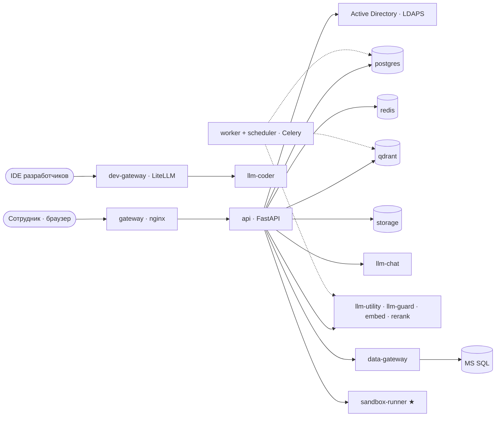

# Обзор архитектуры

Модульный монолит на FastAPI плюс отдельные сервисы только там, где нужна изоляция: инференс моделей,
выполнение кода и доступ к корпоративным БД. Требования — [SPEC §2](../SPEC.md#2-архитектура),
решения — [ADR](../adr/).

## Что уже есть (этап 0)

| Компонент | Где | Состояние |
| --- | --- | --- |
| `api` | `backend/app` | Конфиг с валидацией, structlog с `request_id`, `/health`, `/ready`, `/metrics`, единый формат ошибок, Alembic |
| `web` | `frontend/` | Каркас SPA: роутинг, layout, тема, i18n, типизированный клиент из OpenAPI |
| `fake-llm` | `services/fake-llm` | OpenAI-совместимый mock: чат (стрим, thinking, tool calls, ошибки), эмбеддинги, реранк |
| `mock-ad` | `deploy/mock-ad` | Samba AD DC с тестовыми пользователями, LDAPS |
| `embed` (dev) | `deploy/compose/compose.dev.yml` | bge-m3 на CPU (text-embeddings-inference) |
| `postgres`, `redis`, `qdrant` | `deploy/compose/docker-compose.yml` | Образы закреплены по digest |

Остальные компоненты появляются по этапам [§19](../SPEC.md#19-план-этапов-с-критериями-приёмки).

## Слои бэкенда

- `app/core/` — инфраструктура без бизнес-логики: конфиг, логи, БД, Redis, Qdrant, ошибки, health.
- `app/modules/<модуль>/` — бизнес-модули; у каждого README с интерфейсом и данными.
  Модуль владеет своими таблицами; другие модули обращаются к нему через его сервисы, а не к таблицам.
- `app/cli/` — команды `python -m app.cli …`; `app/workers/` — Celery (с этапа 3).

## Конфигурация

`config/app.yaml` и `config/models.yaml` + оверлеи окружения + `APP_*` + `/run/secrets`; валидация
при старте, справочник — [reference/config.md](../reference/config.md). Подробно — [config/README.md](../../config/README.md).

## Наблюдаемость

- Логи — JSON в stdout (structlog), в каждой записи `request_id`; ключи с секретами маскируются.
- Метрики — `/metrics` (Prometheus), наружу не публикуется.
- Готовность — `/ready` проверяет PostgreSQL, Redis и Qdrant; 503 с причиной по каждой зависимости.
