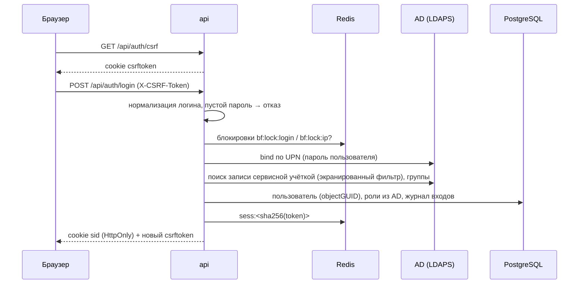

# Безопасность: вход, сессии, права

Требования — [SPEC §6, §15](../SPEC.md#15-безопасность-и-персональные-данные). Здесь — как они
реализованы на этапе 1.

## Вход

- Ошибка любого шага → пользователь видит «Неверный логин или пароль», точная причина — в
  `login_events.failure_reason`. Неудачи увеличивают счётчики перебора (кроме `locked_*` и
  `ad_unavailable`).
- Неверный пароль не повторяется на других контроллерах — иначе одна попытка засчитывалась бы AD
  несколько раз.
- Логин проверяется по белому списку символов, значения в фильтрах LDAP дополнительно экранируются.

## Сессии и CSRF

- Cookie `sid`: непрозрачный токен, `HttpOnly; Secure; SameSite=Lax`. В Redis и Postgres — только
  SHA-256 токена; утечка БД не даёт рабочих сессий.
- TTL в Redis = тайм-аут простоя, продлевается запросами, но не дольше абсолютного срока.
- Каждый запрос заново проверяет пользователя: блокировка администратором или отключение в AD
  завершают все сессии сразу.
- CSRF — double submit: для POST/PUT/PATCH/DELETE под `/api` заголовок `X-CSRF-Token` должен
  совпасть с cookie `csrftoken` и с токеном сессии.

## Права

- Гранулярные права в коде, роли — наборы в БД ([permissions.md](../reference/permissions.md)).
- Каждый админ-эндпоинт объявляет право (`require(Perm.…)`); тест проверяет, что это так для всех.
- Действия админа над чужими данными пишутся в `audit_log` в той же транзакции; журнал — только
  вставка (триггер).

## Тесты безопасности этапа 1 (§18.2)

| Требование | Тест |
| --- | --- |
| Пустой пароль отклоняется до AD | `test_auth_ldap.py::test_empty_password_rejected_before_ad` |
| Спецсимволы в логине не попадают в фильтр | `test_auth_ldap.py::test_ldap_injection_in_login_is_rejected`, `test_auth_units.py::test_user_filter_escapes_values` |
| Каждый админ-эндпоинт требует права | `test_admin.py::test_every_admin_endpoint_requires_permission` |
| Изменяющие запросы без CSRF отклоняются | `test_auth_dev.py::test_unsafe_request_without_csrf_is_rejected` |
| Блокировка завершает сессии | `test_admin.py::test_block_revokes_sessions_and_prevents_login` |
| Журнал аудита не изменяется | `test_admin.py::test_block_revokes_sessions_and_prevents_login` |
